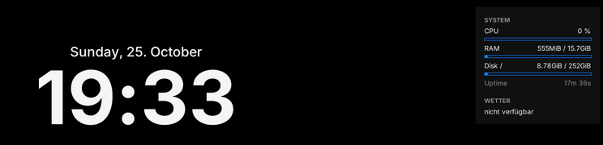

> [!NOTE]
> **Vibe-coded project** – This project was built largely with AI assistance (Claude).
> The code works for my use case but has not been professionally reviewed. Use at your own risk.

[Deutsch](README.md) · **English**

# LinuxMos

Turns Linux Mint Cinnamon into a lightweight macOS look-alike – dock, top bar, widgets, Spotlight and an optional Dynamic Island – without the desktop eating CPU while idle.


---

## Preview

<p align="center">
  
  &nbsp;
  
</p>

---

## Table of contents

- [Features](#features)
- [Requirements](#requirements)
- [Installation](#installation)
- [Usage](#usage)
- [Important notes](#important-notes)
- [Configuration](#configuration)
- [Known issues](#known-issues)
- [Roadmap](#roadmap)
- [License](#license)
- [Credits](#credits)

> The detailed step-by-step guide (including how to do everything by hand) is available in German: [docs/ANLEITUNG.md](docs/ANLEITUNG.md).

---

## Features

**macOS look** (`install.sh`)
- **Theme** – WhiteSur (GTK 3/4, Cinnamon, window borders) with traffic-light buttons on the left, icons, cursor, wallpaper, Inter font
- **Top bar** – Cinnamon panel moved to the top (28 px), logo menu, macOS-style clock
- **Dock** – Plank with a glass theme and zoom on hover
- **Animations** – fast window effects; `--minimal` turns them all off
- **Widgets** – Conky clock and a glass system widget (CPU, RAM, disk, battery, optional weather)
- **Spotlight** – `Super+Space` opens a rofi search (apps, commands, windows, files)
- **Backup & undo** – optional Timeshift snapshot, backup of every changed setting, `uninstall.sh`
- **Update** – `update.sh` fetches new versions without touching your settings



**MosIsland** (optional, `--island`) – a Dynamic Island at the top centre, inspired by [Island](https://github.com/exuupery/island) and [Nusa](https://rama2555.github.io/nusa/). It has its own name so it is not mistaken for exuupery's Island; the command stays `linuxmos-island`.
- **Music** from any MPRIS player (Spotify, Firefox/YouTube, VLC …) with cover art, play/pause/skip and seeking
- **Synced lyrics** (LRCLIB) – the current line lights up, click a line to jump there, optionally shown in the pill
- **Clipboard** – history with search and pins; one click pastes straight into the active window; optionally cleared after X minutes (pins stay)
- **Shelf** – drop files on the island and drag them out again later
- **To-dos** with reminders, a **note**, **Pomodoro** and timers, a **water reminder** with daily goal and chart
- **Weather** (MET Norway, no API key) with rain warning
- **Controls** – Wi-Fi, Bluetooth, Do Not Disturb, dark mode, mic, volume, brightness, screenshot, lock, suspend, restart, power off
- **Live activities** – volume, brightness, Caps Lock, keyboard layout, charging, Wi-Fi lost, headphones connected
- **Mascot** – a pair of eyes while you are away; they doze off and wave when you come back
- **Tray menu** – autostart, mascot, minimal notch, OSD, clipboard auto-clear, quit

**Lightweight** – measured: Conky widgets ~0.03 % CPU, MosIsland ~0.1 % CPU (Cinnamon 6, music playing). No blur compositor, no polling loops.

---

## Requirements

- **Linux Mint 22.x Cinnamon** (based on Ubuntu 24.04), X11 session
- A user with `sudo` rights (the script asks for the password itself)
- Internet connection (apt packages and the WhiteSur themes from GitHub)
- Optional: **Timeshift** set up (for the snapshot before installing)

`install.sh` installs every package itself, e.g. `plank`, `conky-std`, `rofi`, `fonts-inter`, `sassc`; with `--island` also `python3-gi`, `gir1.2-gtk-3.0`, `gir1.2-wnck-3.0`, `gir1.2-xapp-1.0`, `xdotool`, `pulseaudio-utils`.

---

## Installation

### Option A – with Git (recommended, makes `update.sh` work)

```bash
git clone https://github.com/xypep/LinuxMos.git
cd LinuxMos
./install.sh                 # macOS look only
./install.sh --island        # including MosIsland
```

### Option B – as a ZIP

1. On GitHub: **Code → Download ZIP**
2. Extract the archive and `cd` into the folder
3. Run `./install.sh` (to update later: download the new ZIP, then run `./update.sh`)

Then **log out and back in once**.

---

## Usage

1. Install (see above), e.g. `./install.sh --island --weather Berlin`
2. Log out and back in
3. Move the mouse over MosIsland at the top centre – it expands
4. Updates: `./update.sh` · Undo: `./uninstall.sh`

### `install.sh` options

```bash
./install.sh --help
```

| Option              | Effect                                                   |
|---------------------|----------------------------------------------------------|
| `--light`           | Light theme instead of dark mode                         |
| `--minimal`         | All animations off                                       |
| `--weather CITY`    | Weather location for the widget and MosIsland            |
| `--island`          | Install MosIsland                                        |
| `--no-widgets`      | No Conky widgets                                         |
| `--no-spotlight`    | No Spotlight search                                      |
| `--firefox`         | WhiteSur theme for Firefox as well                       |
| `--snapshot` / `--no-snapshot` | Timeshift snapshot without asking / never     |
| `-y`, `--yes`       | Answer "yes" to every question                           |

### More commands

```bash
./update.sh --check          # is there a new version?
./update.sh                  # update (keeps your settings)
./update.sh --full           # also re-apply the design
./uninstall.sh               # restore everything
./uninstall.sh --purge       # also delete themes and MosIsland data
linuxmos-perf                # measure the desktop's CPU load
linuxmos-widgets restart     # restart the Conky widgets
linuxmos-island --tab todo   # open MosIsland on a tab
linuxmos-island --set-city "Munich"
```

### Hotkeys

| Hotkey           | Action                                                      |
|------------------|-------------------------------------------------------------|
| `Super+Space`    | Open/close the Spotlight search                             |
| `Shift+→`        | In the search: switch mode (apps, run, windows, files)      |
| `Ctrl+Alt+I`     | Open/close MosIsland                                        |
| `Ctrl+Alt+V`     | Clipboard history (type to search, `Enter` pastes)          |
| `Esc`            | Collapse MosIsland                                          |
| Mouse wheel on the pill | Volume ±5 %                                          |

---

## Important notes

> [!WARNING]
> `install.sh` changes many Cinnamon settings: panel to the top, window list removed, theme, icons, font, effects, custom shortcuts; `Super+Space` is taken from the keyboard-layout switcher, and with `--island` Cinnamon's volume OSD is turned off. Everything is backed up to `~/.local/share/linuxmos/backup/` first, and `./uninstall.sh` restores it. A Timeshift snapshot beforehand is recommended.

> [!CAUTION]
> `install.sh` downloads the WhiteSur themes straight from GitHub (vinceliuice) and runs their installers; it also installs packages via `sudo apt`. Do not run it with `sudo` – it asks for the password itself.

> [!IMPORTANT]
> Network access: weather via api.met.no and nominatim.openstreetmap.org (MosIsland) or wttr.in (Conky), lyrics via lrclib.net – only when you use the feature. The clipboard history is stored unencrypted in `~/.local/share/linuxmos/island/clipboard.json`; copies from password managers are only skipped if they mark them as secret (KeePassXC and similar).

> [!IMPORTANT]
> Clicking a clipboard entry sends `Ctrl+V` (`Ctrl+Shift+V` in terminals) to the previously active window via `xdotool`.

---

## Configuration

MosIsland: `~/.config/linuxmos/island/config.json` – most switches are also in the tray menu and the water tab.

```json
{
  "city": "Berlin",
  "offset_y": 6,
  "compact_when_idle": false,
  "mascot": true,
  "osd": true,
  "lyrics_in_pill": false,
  "clipboard_limit": 50,
  "clipboard_autodelete_min": 0,
  "water_goal_ml": 2000,
  "water_portion_ml": 250,
  "water_reminders": true,
  "water_start": "09:00",
  "water_end": "21:00",
  "water_interval_min": 60
}
```

Other files:

| File                                          | Contents                                       |
|-----------------------------------------------|------------------------------------------------|
| `~/.config/linuxmos/conky/*.conf`             | Widget position and look (`gap_x`, `gap_y`, `alignment`) |
| `~/.config/linuxmos/rofi/spotlight.rasi`      | Look of the Spotlight search                   |
| `~/.local/share/linuxmos/install.conf`        | Chosen install options (used by `update.sh`)   |
| `~/.local/share/linuxmos/island/`             | MosIsland data: note, to-dos, water log, clipboard history, shelf |

---

## Known issues

- **A complete `install.sh` run on real Mint 22 has not been tested yet** – MosIsland, panel changes, update and uninstall were tested under Cinnamon 6, the WhiteSur install step was not. Please report problems.
- **MosIsland needs ~115 MB RAM** – almost entirely Python + GTK3 itself.
- **No real "genie" effect and no blur** – on purpose, both cost performance all the time.
- **MosIsland is X11 only** (the default on Mint Cinnamon); its UI is German only.
- **Lyrics/weather** depend on LRCLIB and MET Norway – not every song has synced lyrics.
- **While MosIsland is not running** there is no volume OSD (Cinnamon's own is turned off) – switching off "Lautstärke & Helligkeit anzeigen" in the tray menu brings Cinnamon's OSD back.
- **Click-to-paste** does not work in windows running as root – the entry is still on the clipboard.

More solutions (German): [docs/ANLEITUNG.md → Troubleshooting](docs/ANLEITUNG.md#troubleshooting)

---

## Roadmap

- [x] macOS look with theme, top bar, dock, widgets, Spotlight
- [x] Backup, uninstall and update (`update.sh`)
- [x] MosIsland with music, lyrics, clipboard, shelf, to-dos, Pomodoro, water, weather, controls
- [x] Live activities, mascot, tray menu
- [x] Clipboard auto-clear (`clipboard_autodelete_min`)
- [ ] Complete test run on Linux Mint 22.x
- [ ] English UI for MosIsland

---

## License

This project is licensed under the MIT License – see [LICENSE](LICENSE).

The WhiteSur themes (GPL-3.0) are not part of this repository; they are downloaded from the original during installation.

---

## Credits

- [WhiteSur GTK theme, icons, cursors, wallpapers](https://github.com/vinceliuice) – macOS theme (GPL-3.0)
- [Plank](https://launchpad.net/plank) – dock
- [Conky](https://github.com/brndnmtthws/conky) – desktop widgets
- [rofi](https://github.com/davatorium/rofi) – Spotlight search
- [Inter](https://rsms.me/inter/) – font
- [PyGObject / GTK 3](https://pygobject.gnome.org/) – MosIsland UI
- [MET Norway](https://www.met.no/en) (CC BY 4.0), [OpenStreetMap](https://www.openstreetmap.org/copyright) (ODbL), [LRCLIB](https://lrclib.net) – weather, geocoding, lyrics
- Ideas: [Island](https://github.com/exuupery/island) by exuupery and [Nusa](https://rama2555.github.io/nusa/) by Rama (both Windows, closed source) – no code or artwork reused
- Built with the help of Claude (Anthropic)

This project is not affiliated with Apple Inc. "macOS" is a trademark of Apple Inc.
