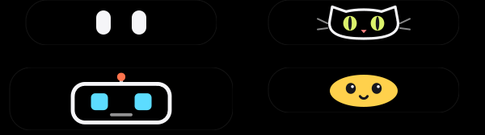
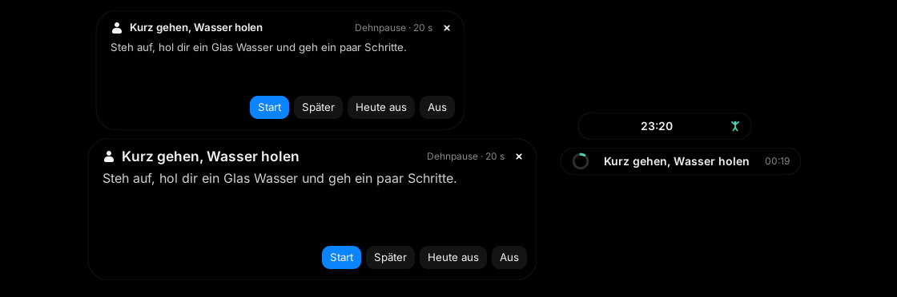

> [!NOTE]
> **Vibe-coded project** – This project was built largely with AI assistance (Claude).
> The code works for my use case but has not been professionally reviewed. Use at your own risk.

[Deutsch](README.md) · **English**

# LinuxMos

Turns Linux Mint Cinnamon into a lightweight macOS look-alike – dock, top bar, widgets, Spotlight and an optional Dynamic Island – without the desktop eating CPU while idle.


---

## Preview

<p align="center">
  
  &nbsp;
  
</p>

---

## Table of contents

- [Features](#features)
- [Requirements](#requirements)
- [Installation](#installation)
- [Usage](#usage)
- [Important notes](#important-notes)
- [Configuration](#configuration)
- [Stretch reminder](#stretch-reminder)
- [Clip transfer](#clip-transfer)
- [Tools & hub](#tools--hub)
- [Tests](#tests)
- [Known issues](#known-issues)
- [Roadmap](#roadmap)
- [License](#license)
- [Credits](#credits)

> The detailed step-by-step guide (including how to do everything by hand) is available in German: [docs/ANLEITUNG.md](docs/ANLEITUNG.md). Every setting with its default and valid range is listed in [docs/CONFIG.md](docs/CONFIG.md) (German).

---

## Features

**macOS look** (`install.sh`)
- **Theme** – WhiteSur (GTK 3/4, Cinnamon, window borders) with traffic-light buttons on the left, icons, cursor, wallpaper, Inter font
- **Top bar** – Cinnamon panel moved to the top (28 px), logo menu, macOS-style clock
- **Dock** – Plank with a glass theme and zoom on hover
- **Animations** – fast window effects; `--minimal` turns them all off
- **Widgets** – Conky clock and a glass system widget (CPU, RAM, disk, battery, optional weather)
- **Spotlight** – `Super+Space` opens a rofi search (apps, commands, windows, files)
- **Backup & undo** – optional Timeshift snapshot, backup of every changed setting, `uninstall.sh`
- **Update** – `update.sh` fetches new versions without touching your settings


**MosIsland** (optional, `--island`) – a Dynamic Island at the top centre, inspired by [Island](https://github.com/exuupery/island) and [Nusa](https://rama2555.github.io/nusa/). It has its own name so it is not mistaken for exuupery's Island; the command stays `linuxmos-island`.
- **Music** from any MPRIS player (Spotify, Firefox/YouTube, VLC …) with cover art, play/pause/skip and seeking
- **Synced lyrics** (LRCLIB) – the current line lights up, click a line to jump there, optionally shown in the pill
- **Clipboard** – history with search and pins; one click pastes straight into the active window; optionally cleared after X minutes (pins stay)
- **Shelf** – drop files on the island and drag them out again later
- **Clip transfer** (optional, off by default) – send text, images and files to another PC over SSH (Linux or Windows): a button on a clipboard entry or shelf file, `Ctrl+Alt+Shift+T` or `linuxmos-clip send`. **Only when you ask for it**, no watcher; what arrives goes to the inbox, the history (marked "empfangen", received) or the shelf and is **never copied automatically** – only a click on the card does that. SSH keys only; with `restrict,command=…` the key can do nothing but deliver clips → [details](#clip-transfer)
- **To-dos** with reminders, a **note**, **Pomodoro** and timers, a **water reminder** with daily goal and chart
- **Weather** (MET Norway, no API key) with rain warning
- **Screenshots** – an area (`Ctrl+Alt+S`) or the monitor under the pointer (`Ctrl+Alt+Shift+S`), straight to the clipboard and `~/Pictures/LinuxMos`; the island hides itself for the shot. Clicking the notice opens the **markup editor** in the island's look (black, floating tool pill): arrow, rectangle, highlighter, text and pixelate for private data
- **Text from the screen (OCR)** – `Ctrl+Alt+O`, drag an area: tesseract (German + English) recognises the text, it goes to the clipboard and shows as a **card** on the island (preview, "To note", "Copy"). Also in the screenshot editor via the "Text" button
- **QR codes & barcodes** – `Ctrl+Alt+Q`: content to the clipboard, an "Open" button for links; for Wi-Fi codes the password is copied and "Connect" is offered
- **Notifications as cards** – every notification shows on top of the island: app icon, picture (avatar, cover), title, text, hides by itself; when several arrive, the newest replaces the old one and counts along ("+2"). A click brings the app to the front, 🔕 hides an app. Cinnamon stays the notification service, the island only listens in; the history stays in the notifications applet
- **Command bar** – `Ctrl+Alt+Space` or the magnifier tab: one input field for apps, files (recently used + home folder), calculator (`12*7`, `sqrt(2)`, `50*20%`), units (`5 km in mi`, `100 f in c`, `1 GiB in MB`), currencies (`20 usd in eur`, ECB rates) and web search (DuckDuckGo, Google, Startpage …). `Enter` opens or copies, `Ctrl+Enter` pastes the result into the previous window or shows the file in its folder. The rofi Spotlight search (`Super+Space`) stays as an alternative
- **Controls** – Wi-Fi, Bluetooth, Do Not Disturb, dark mode, mic, volume, brightness, screenshot, lock, suspend, restart, power off
- **Live activities** – volume, brightness, Caps Lock, keyboard layout, charging, Wi-Fi lost, headphones connected, VPN on/off (optionally with country and IP)
- **Microphone & camera in use** – an orange dot while an app records, a green one while the camera is on (like iOS), with the app's name; opened, the header has a mic button to mute
- **Download progress** – a small ring on the island while Firefox or Chromium/Chrome downloads (with a percentage for Chromium), "Download finished" with a click to the file
- **Several monitors** – the island sits on the primary monitor, a fixed one or the one with the mouse (it moves when a hotkey or the tray opens it); it follows monitors being plugged in and out by itself
- **Screen recording** – `Ctrl+Alt+R` (area) or `Ctrl+Alt+Shift+R` (monitor under the pointer); the same key ends it. MP4 (H.264, with system sound or the microphone if you like) or GIF, saved in `~/Videos/LinuxMos`. The island steps out of the picture, the tray icon turns red (a click ends it), then a card with "Play" and "Show in folder". A forgotten recording stops by itself after 30 minutes
- **AI chat & dictation** (optional, your own API key, off by default) – a chat tab (`Ctrl+Alt+A`), the answer streams in live. Works with any OpenAI-compatible server: OpenAI, OpenRouter, Ollama, LM Studio … The key lives in the keyring (libsecret), not in the config. **Dictation** (`Ctrl+Alt+M`): speak, press the key again – the text is typed into the active window (or lands in the chat field)
- **Mascot** – eyes, a cat, a robot or a blob while you are away; they doze off and wave when you come back
- **Big-eyes mode** – while you are away the pill grows and the character gets 1.5 to 3 times as big (`eye_mode_scale`), temperature and battery go; hover, click or any input brings everything back within about 250 ms. Warnings, music, timers and the stretch card come first. Needs the mascot switched on (`mascot`), otherwise it does nothing
- **Stretch reminder** – after 45 minutes of *active* time at the computer (input within the last minute) the island shows a card with an exercise and a soft two-note chime. "Start" runs a countdown with a ring in the pill, and **"Done" only counts if you really did not type during it.** A real break (5 minutes without input) replaces the stretching, and the card waits during fullscreen and while a focus timer runs. Later, Today off, Off, daily statistics, your own exercises → [details](#stretch-reminder)
- **Clipboard actions** – on every history entry (the "Aktionen" button) and with `Ctrl+Alt+Shift+V` for what is on the clipboard now: strip formatting, remove tracking parameters from links (`utm_*`, `fbclid`, `gclid` …), UPPER/lower/Title case, format or minify JSON, URL and Base64 encode/decode, tidy whitespace, sort lines, remove duplicate lines, QR code (if `qrencode` is installed). The result shows up as a **new** history entry and the original stays; copies marked private (password managers) are never touched → [details](#tools--hub)
- **Colour picker** – `Ctrl+Alt+C`: freezes the screen, a loupe (11×11 pixels, 10× magnified) with the hex value at the pointer, a click picks. Hex, RGB, HSL or HSV goes onto the clipboard, a card shows all formats, the last 20 colours are kept as swatches (pinnable)
- **Keep awake** – `Ctrl+Alt+K` or the tray tick: no screen saver, no screen blanking, no automatic suspend; a coffee cup in the pill, switches itself off after 60 minutes. The lock belongs to the island's D-Bus connection – if the island crashes it is gone
- **Pin a window** – `Ctrl+Alt+P`: the active window stays on top (a pin with the count in the pill, a list with "Aufheben" in the Tools tab)
- **Settings & overview** – `Ctrl+Alt+H`, the gear or the tray entry open a window of its own (its own process, only while it is open): **every function** with hotkey, switch and status, a search box, a click on a name runs the function, a click on the shortcut changes the hotkey (with a conflict warning, effective at once), "what is running now" with the island's CPU and RAM, the pill's **gestures** (wheel, middle/right/double click … freely assignable) and every setting with checked inputs → [details](#tools--hub)
- **Config reload** – changes to `config.json` apply at once (inotify, costs nothing); a typo keeps the old values active and a card names the place in the file. Open it as a file from the settings window ("Config als Datei öffnen") or tray → "Config-Datei öffnen"
- **Tray menu** – settings & overview, keep awake (tick), colour picker, pin the active window, autostart, mascot (pick the character, big-eyes mode), stretch (reminder, today off, stretch now, exercises), minimal notch, OSD, clipboard auto-clear, clip transfer (send, receive), search (files, currencies, search engine), screenshot, text & QR, screen recording (format, sound), AI (chat, dictation, connection & API key), notifications (on/off, do not disturb, hide apps), live hints (mic & camera, VPN, downloads), monitor, language, open config file, quit
- **English or German** – follows the system language automatically, switchable in the tray menu (`Sprache / Language`)

**Lightweight** – measured: Conky widgets ~0.03 % CPU, MosIsland ~0.1 % CPU (Cinnamon 6, music playing) and ~60 MB RAM. No blur compositor, no polling loops.

| MosIsland RAM (Xvfb, fresh profile, 10 s after start) | before (1.9.0) | after (1.10.0) |
|-------------------------------------------------------|----------------|----------------|
| RSS (what `top` shows)                                | 116 MB         | **60 MB**      |
| PSS (shared libraries counted proportionally)         | 87 MB          | **49 MB**      |
| Every tab opened once                                 | –              | 62 MB          |
| CPU while idle (60 s, Xvfb)                           | 0.2 %          | 0.2 %          |

The biggest chunk (−49 MB) was Mesa: GTK loads the OpenGL driver including LLVM at start-up just to pick a window format – yet the island never draws with OpenGL. The rest (−7 MB): tabs are built the first time they open, weather/lyrics/covers/rates come through `curl` instead of Python's HTTPS stack, and freed memory goes back to the system after the island folds. On real hardware the saving depends on the graphics driver – `linuxmos-perf` shows the island's RAM.

Recording, chat and dictation cost nothing while idle: the chat tab is built the first time it opens (measured 59 MB RSS after start-up, +0.7 MB afterwards, idle CPU unchanged), and ffmpeg and curl only run while you record or ask.

**"Wellbeing" package (1.12.0)** – measured in Xvfb with a real Muffin, `linuxmos-perf 60`, 12 s after start:

| MosIsland                                              | RSS     | CPU (60 s) |
|--------------------------------------------------------|---------|------------|
| before (1.11.0)                                        | 59.1 MB | 0.5 %      |
| after, stretch reminder on (default)                   | 59.7 MB | 0.5 %      |
| after, stretch reminder off                            | 59.5 MB | 0.4 %      |
| after, big-eyes mode (`--force-idle`)                  | 58.5 MB | 0.8 %      |
| after, big-eyes mode off (normal mascot)               | 58.7 MB | 0.9 %      |

The package costs about 0.6 MB of RAM. The CPU values are higher in this environment (software rendering, 0.5 % even before) than on real hardware (0.1–0.2 %); the comparison is what counts: the reminder's tick can't be measured (over 120 s with a tick every 5 s, twelve times as often as in use: 760 ms CPU, 763 ms without the reminder). The big eyes cost as much as the small ones – the blinking was there before.

**"Clip transfer" package (1.13.0)** – measured like above (Xvfb with a real Muffin, `linuxmos-perf 60`, 12 s after start, fresh profile), every row a separate start:

| MosIsland                                                          | RSS     | PSS     | CPU (60 s) |
|--------------------------------------------------------------------|---------|---------|------------|
| before (1.12.0)                                                    | 59.9 MB | 42.4 MB | 0.2 % (13 ticks) |
| after, transfer off (default): **nothing loaded, no monitor**      | 60.1 MB | 42.5 MB | 0.2 % (13 ticks) |
| after, receiving only (one inotify monitor)                        | 60.4 MB | 42.7 MB | 0.2 % (13 ticks) |
| after, sending only                                                | 60.5 MB | 42.8 MB | 0.2 % (14 ticks) |
| after, both on                                                     | 60.4 MB | 42.8 MB | 0.2 % (13 ticks) |
| after, both on, text + image received, clipboard tab opened        | 61.3 MB | 43.5 MB | 0.2 % (13 ticks) |
| for comparison: before (1.12.0) with the clipboard tab opened once | 60.6 MB | 42.9 MB | 0.2 % (12 ticks) |

"Ticks" are CPU time in hundredths of a second during the 60 s (13 ticks = 0.13 s). The package costs 0.2 to 0.6 MB of RAM while idle (0.7 MB more than before once content was received and the tab opened); the CPU load does not change measurably. Off means off: with sending and receiving off the module is not even imported (the log says `clip: disabled, no monitors`). A first draft cost 4 MB because `dataclasses`, `secrets` (→ OpenSSL) and `subprocess` stayed in memory; the core now only uses standard modules the island has loaded anyway. No daemon, no polling, no permanent SSH connection: one `ssh` process per clip, which ends afterwards.

**"Tools & hub" package (1.14.0)** – measured as above, every row its own start with a fresh profile, 12 s after start, `linuxmos-perf 60`; "ticks" are CPU time in hundredths of a second during the 60 s. So that before and after are in the same state, with `--force-idle` (the mascot from the start, which blinks – the most expensive idle state):

| MosIsland                                              | RSS     | PSS     | CPU (60 s)       |
|--------------------------------------------------------|---------|---------|------------------|
| before (1.13.0), run 1                                 | 59 MB   | 39 MB   | 0.8 % (49 ticks) |
| before (1.13.0), run 2                                 | 59 MB   | 39 MB   | 0.8 % (49 ticks) |
| after (1.14.0), run 1                                  | 60 MB   | 40 MB   | 0.8 % (47 ticks) |
| after (1.14.0), run 2                                  | 59 MB   | 40 MB   | 0.8 % (51 ticks) |
| after, all new features off                            | 59 MB   | 40 MB   | 0.7 % (42 ticks) |
| after, keep awake on + one window pinned (without `--force-idle`) | 61 MB | 34 MB | 0.7 % (41 ticks) |
| after, "Werkzeuge" tab opened, colour picker used 3× (without `--force-idle`) | 62 MB | 37 MB | 0.4 % (26 ticks) |
| after, settings window open                            | island 60 MB, window (own process) 63 MB | – | 0.7 % (44 ticks) |

The package costs **about 0.5 to 1 MB of RAM** while idle (new modules, the register with 41 entries, the D-Bus object), the CPU load does not change measurably: there is no new timer, no tick, no polling. Keep awake is a lock without a tick (one timer on the end time), pins only attach one signal to the screen while a window is pinned. Without `--force-idle` the state decides the number, not the version: right after input (the pill shows the clock) it is about 25 ticks, after a minute of rest (blinking mascot) about 40 to 47 – measured the same with 1.13.0 (25 and 47 ticks in two runs). PSS depends on how many other processes share the same pages and so varies between 34 and 41 MB. **The colour picker** needs 15 MB more while it is open (the still), 60.6 MB → 75 MB → **61.0 MB** after closing, also after the third time; a first draft that read the screen through GDK kept 15 MB for good (GDK keeps a shared-memory image attached), so `maim` takes the picture now. **The settings window** is a process of its own (63 MB while open) and gone afterwards: `pgrep -f island.settings` is empty.

---

## Requirements

- **Linux Mint 22.x Cinnamon** (based on Ubuntu 24.04), X11 session
- A user with `sudo` rights (the script asks for the password itself)
- Internet connection (apt packages and the WhiteSur themes from GitHub)
- Optional: **Timeshift** set up (for the snapshot before installing)

`install.sh` installs every package itself, e.g. `plank`, `conky-std`, `rofi`, `fonts-inter`, `sassc`; with `--island` also `python3-gi`, `gir1.2-gtk-3.0`, `gir1.2-wnck-3.0`, `gir1.2-xapp-1.0`, `xdotool`, `pulseaudio-utils`, `iso-codes`, `ffmpeg` (recording, dictation) and `libsecret-tools` (API key in the keyring). **Optional, not installed automatically:** `qrencode` (`sudo apt install qrencode`) for the clipboard's "QR code" action.

---

## Installation

### Option A – with Git (recommended, makes `update.sh` work)

```bash
git clone https://github.com/xypep/LinuxMos.git
cd LinuxMos
./install.sh                 # macOS look only
./install.sh --island        # including MosIsland
```

### Option B – as a ZIP

1. On GitHub: **Code → Download ZIP**
2. Extract the archive and `cd` into the folder
3. Run `./install.sh` (to update later: download the new ZIP, then run `./update.sh`)

Then **log out and back in once**.

---

## Usage

1. Install (see above), e.g. `./install.sh --island --weather Berlin`
2. Log out and back in
3. Move the mouse over MosIsland at the top centre – it expands
4. Updates: `./update.sh` · Undo: `./uninstall.sh`

### `install.sh` options

```bash
./install.sh --help
```

| Option              | Effect                                                   |
|---------------------|----------------------------------------------------------|
| `--light`           | Light theme instead of dark mode                         |
| `--minimal`         | All animations off                                       |
| `--weather CITY`    | Weather location for the widget and MosIsland            |
| `--island`          | Install MosIsland                                        |
| `--no-widgets`      | No Conky widgets                                         |
| `--no-spotlight`    | No Spotlight search                                      |
| `--firefox`         | WhiteSur theme for Firefox as well                       |
| `--snapshot` / `--no-snapshot` | Timeshift snapshot without asking / never     |
| `-y`, `--yes`       | Answer "yes" to every question                           |

### More commands

```bash
./update.sh --check          # is there a new version?
./update.sh                  # update (keeps your settings)
./update.sh --full           # also re-apply the design
./uninstall.sh               # restore everything
./uninstall.sh --purge       # also delete themes and MosIsland data
linuxmos-perf                # measure the desktop's CPU load and the island's RAM
linuxmos-widgets restart     # restart the Conky widgets
linuxmos-island --tab todo   # open MosIsland on a tab
linuxmos-island --shot area  # screenshot: area | screen (monitor under the pointer)
linuxmos-island --ocr        # recognise the text in an area
linuxmos-island --qr         # read a QR code/barcode in an area
linuxmos-island --record area  # screen recording: area | screen; call again = stop
linuxmos-island --chat       # open the AI chat
linuxmos-island --voice      # start dictation, call again = recognise the text
linuxmos-island --set-key    # store the AI chat's API key in the keyring
linuxmos-island --set-city "Munich"
linuxmos-island --clip-send  # send the clipboard to the default peer (clip transfer, only when called)
linuxmos-clip setup          # set up clip transfer: key, peer, confirm the fingerprint
linuxmos-clip doctor         # check clip transfer (ssh, key, peer, sshd, inbox)
echo hello | linuxmos-clip send --peer Laptop   # send text/a file from the command line
linuxmos-island --settings   # settings & overview (a window of its own), --tab overview|gestures|functions
linuxmos-island --action ID  # run a function from the register, e.g. color-picker, keep-awake, pin-window, clip-actions
linuxmos-island --list-actions  # every function as a table (--markdown: the hotkey table for the README)
linuxmos-island --check-hotkeys # check the hotkeys for conflicts (among themselves and with Cinnamon/Mint)
linuxmos-island --stretch-now   # show a stretch card right away (also while the island runs)
linuxmos-island --stretch-test  # test: 1-minute interval, idle thresholds in seconds (at start-up only)
linuxmos-island --force-idle    # test: mascot/big eyes without waiting, hover ends it (at start-up only)
LINUXMOS_LOG=debug linuxmos-island   # log with every measurement (default: info)
```

### Hotkeys

| Hotkey           | Action                                                      |
|------------------|-------------------------------------------------------------|
| `Super+Space`    | Open/close the Spotlight search                             |
| `Shift+→`        | In the search: switch mode (apps, run, windows, files)      |
| `Ctrl+Alt+I`     | Open/close MosIsland                                        |
| `Ctrl+Alt+V`     | Clipboard history (type to search, `Enter` pastes)          |
| `Ctrl+Alt+Space` | MosIsland's command bar: apps, files, calculator, units, currencies, web (`↑`/`↓`, `Enter`, `Ctrl+Enter`) |
| `Ctrl+Alt+S`     | Screenshot of an area (`Esc` or the hotkey again cancels)   |
| `Ctrl+Alt+Shift+S` | Screenshot of the monitor under the pointer               |
| `Ctrl+Alt+O`     | Recognise the text in an area (OCR) → clipboard             |
| `Ctrl+Alt+Q`     | Read a QR code/barcode in an area → clipboard               |
| `Ctrl+Alt+R`     | Start recording an area (again = stop and save)             |
| `Ctrl+Alt+Shift+R` | Record the monitor under the pointer                      |
| `Ctrl+Alt+A`     | Open the AI chat (with `ai_chat`)                           |
| `Ctrl+Alt+M`     | Dictation: record, press again = recognise and paste (with `ai_voice`) |
| `Ctrl+Alt+Shift+T` | Send the clipboard to the default peer (with "Clip-Senden"; `Ctrl+Alt+T` is Cinnamon's terminal) |
| `Ctrl+Alt+Shift+V` | Actions for the clipboard's content (formatting, links, JSON, Base64 …) |
| `Ctrl+Alt+C`     | Colour picker: loupe at the pointer, click picks, `Esc` cancels, wheel resizes the loupe |
| `Ctrl+Alt+K`     | Keep awake on/off                                           |
| `Ctrl+Alt+P`     | Pin / unpin the active window                               |
| `Ctrl+Alt+H`     | Settings & overview ("Übersicht" tab)                       |
| In the editor    | `A` arrow · `R` rectangle · `M` highlighter · `T` text · `B` pixelate · `O` recognise text · `1`–`6` color · `Ctrl+Z` · `Ctrl+C` · `Ctrl+S` = Done |
| `Esc`            | Collapse MosIsland                                          |
| Mouse wheel on the pill | Volume ±5 % (re-assignable, see [gestures](#tools--hub)) |

Every key can be changed in the settings window ("Übersicht" tab, click the shortcut) and lives in the config under `hotkeys`. The table matches the island's register; `linuxmos-island --list-actions` shows it with the **real** values, `--check-hotkeys` checks for conflicts.

---

## Important notes

> [!WARNING]
> `install.sh` changes many Cinnamon settings: panel to the top, window list removed, theme, icons, font, effects, custom shortcuts; `Super+Space` is taken from the keyboard-layout switcher, and with `--island` Cinnamon's volume OSD is turned off. Everything is backed up to `~/.local/share/linuxmos/backup/` first, and `./uninstall.sh` restores it. A Timeshift snapshot beforehand is recommended.

> [!CAUTION]
> `install.sh` downloads the WhiteSur themes straight from GitHub (vinceliuice) and runs their installers; it also installs packages via `sudo apt`. Do not run it with `sudo` – it asks for the password itself.

> [!IMPORTANT]
> Network access: weather via api.met.no and nominatim.openstreetmap.org (MosIsland) or wttr.in (Conky), lyrics via lrclib.net – only when you use the feature. The command bar gets exchange rates from api.frankfurter.dev (ECB rates, no account) – only when you type a currency conversion, at most every 12 hours; switch it off with `command_bar_currency`. The web search sends what you typed to the chosen search engine only when you press `Enter`. The VPN's country and IP come from ipinfo.io – only with `vpn_lookup` (off by default), once per VPN connection; ipinfo.io sees the VPN's exit IP. The clipboard history is stored unencrypted in `~/.local/share/linuxmos/island/clipboard.json`; copies from password managers are only skipped if they mark them as secret (KeePassXC and similar).

> [!IMPORTANT]
> Clip transfer is off until you switch "Clip-Senden" and/or "Clip-Empfang" on in the tray menu. Something is sent only when you ask for it (button, `Ctrl+Alt+Shift+T`, `linuxmos-clip send`), never automatically, and only over SSH (key, `StrictHostKeyChecking=yes`) to peers you set up with `linuxmos-clip setup` and whose fingerprint you confirmed. The receiver needs a running SSH server (port 22; `openssh-server` is not installed automatically). **The history, the inbox (`~/.local/share/linuxmos/island/clip-inbox/`) and received files (`~/Downloads/LinuxMos/`) are stored unencrypted**, like the clipboard history; copies marked private (KeePassXC) are neither stored nor sent. What arrives never lands on the clipboard by itself and is never opened. [Security in detail](docs/CLIP.md#sicherheit) (German)

> [!IMPORTANT]
> AI chat and dictation are off until you switch them on in the tray menu under "AI". After that they send your question or your voice recording to the server in `ai_base_url` (empty: OpenAI) – only when you send something. The conversation stays in memory, the dictation recording (`~/.cache/linuxmos/island/recordings/dictation.wav`) is deleted as soon as the text is back. The API key lives in the keyring (`secret-tool`), never in `config.json`, and reaches `curl` through standard input only, so it is not in the process list either. A local server (Ollama, LM Studio on `localhost`) needs no key and sends nothing to the internet.

> [!IMPORTANT]
> During a screen recording the island stays invisible so it does not end up in the video, and notifications do not show as cards (they wait in the notification applet). The recording captures everything that is on the screen – including passwords you type there.

> [!IMPORTANT]
> While MosIsland shows notifications as cards, it turns Cinnamon's own banners off (`org.cinnamon.desktop.notifications display-notifications`) – notifications then go to the notifications applet without a popup, the island shows the card. Quitting the island or switching off tray → "Notifications" → "Show on the island" brings Cinnamon's banners back. "Do not disturb" (controls tab, tray) then applies to the island; critical ones (e.g. battery almost empty) still come through. The cards show message contents large at the top centre – consider "Do not disturb" while sharing your screen.

> [!IMPORTANT]
> Clicking a clipboard entry sends `Ctrl+V` (`Ctrl+Shift+V` in terminals) to the previously active window via `xdotool`.

---

## Configuration

MosIsland: `~/.config/linuxmos/island/config.json` – most switches are also in the tray menu and the water tab.

```json
{
  "city": "Berlin",
  "language": "auto",
  "offset_y": 6,
  "monitor": "primary",
  "compact_when_idle": false,
  "mascot": true,
  "mascot_style": "eyes",
  "osd": true,
  "lyrics_in_pill": false,
  "clipboard_limit": 50,
  "clipboard_autodelete_min": 0,
  "clip_send_enabled": false,
  "clip_receive_enabled": false,
  "clip_max_text_kb": 1024,
  "clip_max_image_mb": 20,
  "clip_max_file_mb": 100,
  "clip_inbox_keep_days": 7,
  "clip_inbox_quota_mb": 500,
  "clip_default_peer": "",
  "clip_peers": [],
  "screenshot_save": true,
  "screenshot_dir": "",
  "screenshot_open_editor": false,
  "ocr_languages": "deu+eng",
  "ocr_keep_linebreaks": false,
  "qr_open_links": false,
  "notifications_on_island": true,
  "notifications_dnd": false,
  "notifications_exclude": [],
  "privacy_indicator": true,
  "vpn_status": true,
  "vpn_lookup": false,
  "downloads_progress": true,
  "downloads_dir": "",
  "record_format": "mp4",
  "record_audio": "off",
  "record_fps": 30,
  "record_max_min": 30,
  "record_dir": "",
  "ai_chat": false,
  "ai_voice": false,
  "ai_voice_autopaste": true,
  "ai_base_url": "",
  "ai_model": "",
  "ai_stt_model": "",
  "ai_system_prompt": "",
  "ai_history": 20,
  "ai_voice_language": "",
  "ai_voice_max_s": 120,
  "command_bar_engine": "duckduckgo",
  "command_bar_files": true,
  "command_bar_currency": true,
  "water_goal_ml": 2000,
  "water_portion_ml": 250,
  "water_reminders": true,
  "water_start": "09:00",
  "water_end": "21:00",
  "water_interval_min": 60,
  "stretch_enabled": true,
  "stretch_interval_min": 45,
  "stretch_break_reset_min": 5,
  "stretch_idle_skip_min": 30,
  "stretch_snooze_min": 5,
  "stretch_snooze_max": 2,
  "stretch_escalate": true,
  "stretch_verify_idle": true,
  "stretch_long_per_day": 2,
  "stretch_sound": true,
  "stretch_volume": 0.5,
  "stretch_off_date": "",
  "eye_mode": true,
  "eye_mode_scale": 2.0,
  "clipactions_enabled": true,
  "clipactions_tracking_params": [],
  "colorpicker_enabled": true,
  "colorpicker_format": "hex",
  "colorpicker_history": 20,
  "keepawake_enabled": true,
  "keepawake_minutes": 60,
  "pin_enabled": true,
  "pin_release_on_exit": true,
  "hotkeys": {},
  "gestures_enabled": true,
  "gestures": {},
  "overview_intro_seen": false
}
```

The easiest way is the **settings window** (the gear at the top right of the opened island, `Ctrl+Alt+H`, tray → "Einstellungen & Übersicht"): its "Funktionen" tab has an input for every key that checks the value. As a file: the "Config als Datei öffnen" link in the window or tray → "Config-Datei öffnen" – that adds missing keys with their defaults and opens the file with `xdg-open` (else `gio open`, else `xed`), that is, in your default program for `.json` files. Save and it applies at once, no restart. If the JSON is invalid, the old values stay active, a card says "Config ungültig, alte Werte bleiben" (invalid config, old values stay) with line and column, and the island does not write to the file until it is right again. Unknown keys are kept, values outside the valid range are clamped. **Every key with its default, meaning and range: [docs/CONFIG.md](docs/CONFIG.md)** (German).

`language`: `auto` (system language: German for `de_*`, English otherwise), `de` or `en`. Switching it in the tray menu restarts MosIsland briefly (a running timer is lost).

`monitor`: `"primary"` (primary monitor, default), `"pointer"` (the monitor the mouse is on when you open the island via a hotkey or the tray – folded, it stays there until you open it somewhere else), a number from the left (`0` = leftmost, `1` = the one next to it …) or the connector name as in `xrandr --listmonitors` (`"HDMI-1"`, `"DP-2"`, `"eDP-1"`). If the chosen monitor is not connected, the island goes to the primary monitor and comes back when it is plugged in – the setting stays. The tray menu lists all connected monitors under "Monitor"; it stores the name, because the numbers can shift when monitors are replugged.

Clip transfer: `clip_send_enabled` and `clip_receive_enabled` switch sending and receiving separately (both off; also in the tray menu under "Clip-Transfer"). `clip_max_text_kb`, `clip_max_image_mb`, `clip_max_file_mb` are the limits the **receiver enforces while reading**; `clip_inbox_keep_days` and `clip_inbox_quota_mb` tidy the inbox (at start-up and when something arrives, no timer) and refuse too much. `linuxmos-clip setup` writes `clip_peers`; an entry looks like `{"name": "Windows-PC", "host": "192.168.0.50", "user": "alec", "port": 22, "key": "~/.ssh/linuxmos_clip_ed25519", "os": "windows"}`; `clip_default_peer` is where the hotkey and `linuxmos-clip send` without `--peer` go. Everything in detail (German): [docs/CLIP.md](docs/CLIP.md), [docs/CONFIG.md](docs/CONFIG.md#clip-transfer).

Screenshots: `screenshot_save` also keeps every shot as a PNG (otherwise clipboard only), `screenshot_dir` changes the folder (empty = `~/Pictures/LinuxMos`, localised like `~/Bilder/LinuxMos`), `screenshot_open_editor` opens the editor right after the shot. "Done" in the editor overwrites the shot with the marked-up version. All of it is also in the tray menu under "Screenshot".

Text & QR: `ocr_languages` are tesseract languages joined with `+` (more via `sudo apt install tesseract-ocr-fra` etc., list: `tesseract --list-langs`). By default the lines of a paragraph are joined and hyphens at line ends removed; `ocr_keep_linebreaks` keeps the text line by line. `qr_open_links` opens links from QR codes in the browser right away instead of showing an "Open" button. Both switches are also in the tray menu under "Text & QR". Recognition runs entirely locally, the image is deleted afterwards.

Notifications: `notifications_on_island` shows them as cards on the island (and turns Cinnamon's banners off for that), `notifications_dnd` is the island's "do not disturb", `notifications_exclude` a list of app names (as shown on the card) or desktop IDs (`firefox`, `org.telegram.desktop`) that never show as a card – e.g. `["Spotify", "Thunderbird"]`. All of it is also in the tray menu under "Notifications", which lists the recently seen apps to tick off. The island only listens in via a D-Bus monitor and stores none of it (only the app names for that list, in `~/.local/share/linuxmos/island/notifications.json`).

Live hints: `privacy_indicator` shows the orange (microphone) and green (camera) dot; the microphone comes from PipeWire/PulseAudio (`pactl subscribe`, level meters like pavucontrol don't count), the camera from inotify on `/dev/video*`. `vpn_status` reports VPN on/off (NetworkManager VPNs, WireGuard and the tun/wg interfaces of other VPN apps such as Mullvad), `vpn_lookup` adds country and IP from ipinfo.io (an outside request, hence off by default). `downloads_progress` watches the download folder (`downloads_dir`, empty = the XDG download folder, e.g. `~/Downloads`) for `.part` (Firefox) and `.crdownload` (Chromium/Chrome) files. All of it is also in the tray menu under "Live hints".

Command bar: `command_bar_engine` is the search engine (`duckduckgo`, `google`, `startpage`, `ecosia`, `bing`, `brave` or your own URL with `%s` for the query, e.g. `"https://en.wikipedia.org/w/index.php?search=%s"`). `command_bar_files` searches files: recently used ones and everything in the home folder up to 5 levels deep (no hidden folders, at most 20,000 entries); the list is built in a thread when you first type and dropped again 3 minutes after the last search. `command_bar_currency` converts currencies with the ECB rates (see network access above). Apps you start from the command bar move up (counter in `~/.local/share/linuxmos/island/command.json`). All of it is also in the tray menu under "Search".

Mascot: `mascot_style` is `eyes` (the default), `cat`, `robot` or `blob`; `mascot` switches it off altogether. Both in the tray menu under "Mascot".

Big-eyes mode: `eye_mode` (on by default, tray → "Mascot" → "Augen-Modus (groß im Leerlauf)") makes the character grow by `eye_mode_scale` while you are away (the same moment the mascot comes out), 1.5 to 3.0 – values outside are clamped. With the mascot off (`mascot: false`) it does nothing. If something else is on show in the pill (music, a timer, the stretch countdown, the stretch mark) the normal pill stays; cards and hints (battery low, Wi-Fi gone, the stretch card …) appear as usual and the eyes come back afterwards. The microphone/camera dots stay visible.



Screen recording: `record_format` is `mp4` or `gif` (GIFs have at most 15 frames per second, 960 px width and no sound), `record_audio` `off`, `system` (what the speakers play) or `mic` (MP4 only), `record_fps` 1–60, `record_max_min` ends a recording after that many minutes (`0` = never), `record_dir` changes the folder (empty = `~/Videos/LinuxMos`). The picture comes from ffmpeg (`x11grab`) and needs X11. Format and sound also in the tray menu under "Screen recording".

AI: `ai_chat` shows the chat tab, `ai_voice` enables dictation, `ai_voice_autopaste` types the dictation into the previous window (otherwise a card with "Paste"). `ai_base_url` is the server's address up to `/v1` (empty = `https://api.openai.com/v1`, Ollama: `http://localhost:11434/v1`), `ai_model` the chat model (empty = `gpt-4o-mini`), `ai_stt_model` the model for dictation (empty = `whisper-1`; the server needs `/audio/transcriptions`). `ai_system_prompt` replaces the short default instruction, `ai_history` is the number of messages sent along, `ai_voice_language` a language code like `en` (empty = detect), `ai_voice_max_s` the longest dictation. Set address, models and key in the tray menu under "AI" → "Connection & API key …", or the key with `linuxmos-island --set-key`.

Other files:

| File                                          | Contents                                       |
|-----------------------------------------------|------------------------------------------------|
| `~/.config/linuxmos/conky/*.conf`             | Widget position and look (`gap_x`, `gap_y`, `alignment`) |
| `~/.config/linuxmos/rofi/spotlight.rasi`      | Look of the Spotlight search                   |
| `~/.local/share/linuxmos/install.conf`        | Chosen install options (used by `update.sh`)   |
| `~/.local/share/linuxmos/island/`             | MosIsland data: note, to-dos, water log, clipboard history, shelf, stretch statistics (`stretch.json`, 30 days) |
| `~/.local/share/linuxmos/island/clip-inbox/`  | Clip inbox (mode 700): received text and images with their entries; tidied after `clip_inbox_keep_days` |
| `~/Downloads/LinuxMos/`                       | Files received through clip transfer (they always stay, also after `uninstall.sh`) |
| `~/.ssh/linuxmos_clip_ed25519`                | The clip transfer's key, meant for that only (`linuxmos-clip setup`; `uninstall.sh --purge` deletes it) |
| `~/.config/linuxmos/island/stretch_exercises.json` | Your stretch exercises (name, text, seconds, `long`) – created with the default list the first time |
| `~/.cache/linuxmos/island/stretch-*.wav`      | The two chimes of the stretch reminder, made by the island on first use (`uninstall.sh` removes them) |

---

## Stretch reminder

<p align="center"></p>

All on the island, no dialog windows. The main switch is tray → "Dehnen" → "Dehn-Erinnerung" (`stretch_enabled`), plus "Heute aus" (today off, until midnight) and the "Dehnen" tab. **Off means off:** no timer, no tick, no query (the log says `stretch: disabled, no timers`). The stretch texts are German only.

**When it comes**
- Only *active* time counts: one tick a minute asks once how long ago the last input was (Muffin's IdleMonitor, which the island already uses for the mascot; outside Cinnamon libXss takes over). Input within the last minute makes the minute count. While the computer sits idle the tick slows to every 5 minutes.
- **5 minutes without input** (`stretch_break_reset_min`) is a real break: counting starts over and no card follows.
- If it falls due while the screen is off or locked (`cinnamon-screensaver-command -q`, `xset q`, asked once, only then) or the last input is older than `stretch_idle_skip_min`, it is dropped and counting starts again on your return.
- **Fullscreen** (film, game): it waits and comes once you leave. The island listens to libwnck's window signals, it asks nothing. **Focus timer:** while one runs no card comes; if it falls due meanwhile, it comes at the end of the focus phase, before the break. If nothing is due then, nothing happens.

**The card:** exercise name, instruction, "Start", "Später" (later), "Heute aus", "Aus" (sets `stretch_enabled` to `false` and briefly shows how to switch it on again). The card folds after 15 s and leaves a small figure at the pill's right end until you react; a click on it brings the card back. Before the card the eyes blink twice (if they are on show).

**Against just clicking "done"**
- "Start" runs a countdown (short exercises 10–20 s, long ones 30–60 s) with a ring at the pill's left. "Erledigt" (done) only comes after it and only counts if the idle time at the end is at least **70 %** of the countdown (`stretch_verify_idle`). Otherwise: "Du warst am Rechner, noch mal?" (you were at the computer, again?) – the second time it counts as "unconfirmed".
- "Später" at most twice per round (5, then 3 minutes), after that only Start or "Überspringen" (skip).
- An ignored card comes back after 3 minutes, bigger and with a slightly higher chime, at most three times (`stretch_escalate`), then it counts as missed.
- The daily statistics (done, unconfirmed, later, skipped, missed; 30 days) are in the "Dehnen" tab and in `~/.local/share/linuxmos/island/stretch.json`.

**Exercises** live in `~/.config/linuxmos/island/stretch_exercises.json` (tray → Dehnen → "Übungen bearbeiten …") and you can extend them: `name`, `text`, `seconds`, `long`. They rotate without an immediate repeat; every fourth reminder is a long one (`long: true`), at most `stretch_long_per_day` times a day.

**Sound:** a soft two-note chime (C5 → E5, about 0.5 s, fading in and out), a little higher and longer when the card returns (E5 → G5), and the first one again at the end of the countdown. The island makes the two WAV files from sine waves on first use (nothing from third parties) in `~/.cache/linuxmos/island/` and plays them with `paplay`; `stretch_sound` and `stretch_volume` (0.0–1.0) control it.

None of this leaves the computer: no network requests, and the island only stores the statistics' numbers, never what you type.

---

## Clip transfer

Text, images and files between PCs over SSH – Linux ↔ Linux tested in the container, Windows as documentation only (untested). Step-by-step setup (German): **[docs/CLIP.md](docs/CLIP.md)**, Windows: [docs/CLIP-WINDOWS.md](docs/CLIP-WINDOWS.md), keys: [docs/CONFIG.md](docs/CONFIG.md#clip-transfer). The clip texts are German only.

**Manual only**
- **Sending** only on your explicit action: the "An PC senden" (paper plane) button on clipboard entries and shelf files, `Ctrl+Alt+Shift+T` (sends the **current** clipboard to the default peer: text, an image or a file copied in Nemo), `linuxmos-island --clip-send` or `linuxmos-clip send`. No watcher, no `owner-change`, nothing automatic – checked: change the clipboard several times → no `ssh` process, nothing arrives at the receiver. Several peers: a small choice row, otherwise straight to the default peer.
- **Receiving** is passive: the clip goes to the inbox folder, the clipboard history (text, image, marked "empfangen") or the shelf and `~/Downloads/LinuxMos/` (files), with a card "Vom Windows-PC empfangen: Text (123 Zeichen)". **Nothing is written to the clipboard automatically**; a click on the card or entry copies it (and types nothing into a window). During fullscreen (or while the island is open, a capture runs or another card shows) the card waits and appears afterwards; if the island is not running the entry waits until it starts.
- Copies marked private (password managers) are never sent. The result is always a card: "Gesendet an …" or the reason (unreachable, key refused, host key unknown, too large …), never a dialog window.

**Security**
- Transport: a single `ssh` call per clip, data on stdin and streamed (never loaded completely), `BatchMode=yes`, `StrictHostKeyChecking=yes`, `ControlMaster=no`, `IdentitiesOnly=yes`, `ConnectTimeout=5`; asynchronous (`Gio.Subprocess`), the UI never blocks.
- `linuxmos-clip setup` creates `~/.ssh/linuxmos_clip_ed25519` (ed25519, mode 600), shows the receiver's **fingerprint** the first time and demands a deliberate confirmation (no silent `accept-new`), and prints the `authorized_keys` line: `restrict,command="~/.local/bin/linuxmos-clip receive-ssh" ssh-ed25519 AAAA…`. With it the key can do **nothing but deliver clips**.
- `receive-ssh` checks `SSH_ORIGINAL_COMMAND` against a strict regex (only `receive --type text|image|file` and optionally `--name` with `[A-Za-z0-9._ -]{1,120}`) and never runs anything through a shell. The receiver enforces the limits (text 1 MB, image 20 MB, file 100 MB) **while reading stdin** and cleans up on abort; everything is written atomically (temporary file, then `rename`, the entry last). File names are sanitised (no path, no `..`, no leading dot, no control characters, limited length, collisions numbered, never overwritten, symlinks neither followed nor created).
- No network port of the island. History and inbox are plain text (see "Important notes").

`linuxmos-clip`: `setup`, `doctor`, `send`, `receive`, `receive-ssh`, `apply [ID]` (via `xclip`, optional only), `list`, `clean`, `--selftest`.

---

## Tools & hub

Package "Tools & hub" (1.14.0). Everything can be switched off on its own (settings window, `config.json`); off means off: no handlers, no timers, no locks – the log says so (`keepawake: disabled, no lock, no timer`, `pins: disabled, no handlers`, `gestures: disabled, no handlers` …). The texts of this package exist in German only.

### Clipboard actions

The **Aktionen** button (the three dots) on a history entry, or `Ctrl+Alt+Shift+V` for what is on the clipboard now. The actions appear as buttons, a click runs one:

| Action | What happens |
|---|---|
| Formatierung entfernen (strip formatting) | Plain text only (HTML/RTF leaves the clipboard) |
| Tracking aus Links entfernen (remove tracking) | `utm_*`, `fbclid`, `gclid`, `msclkid`, `mc_eid`, `igshid`, `ref_src` and the like disappear from every link in the text; functional parameters (`id`, `page`, `q`, `ref`, `v` …) and the rest stay character for character. More names in `clipactions_tracking_params` ("Link bereinigt, 3 Parameter entfernt") |
| GROSS · klein · Titel-Schreibweise | `don't` becomes `Don't`, not `Don'T` |
| JSON formatieren / zusammenfassen | Order and umlauts stay; broken JSON: a card with line and column, the clipboard stays as it was |
| URL kodieren / dekodieren · Base64 kodieren / dekodieren | Base64 also takes the URL-safe alphabet and missing `=`; binary data is refused |
| Leerzeichen bereinigen | Doubled spaces, trailing spaces, more than one blank line, the ends |
| Zeilen sortieren · Doppelte Zeilen entfernen | Sorted ignoring case; removing keeps the first one |
| QR-Code | Only if `qrencode` is installed (otherwise the button is missing): a card with the code, "Als Bild kopieren" |

The result replaces the clipboard only after the click and appears as a **new history entry** – the original stays. The card offers "Original zurück" and "Einfügen". **Copies marked private (KeePassXC & co.) are never processed** (card "Als privat markiert"; they never enter the history either). Plain text functions: nothing runs while idle.

### Colour picker

`Ctrl+Alt+C`, the button in the "Werkzeuge" tab or tray → "Farbpipette starten". The island hides, the whole screen (all monitors, also with HiDPI scaling) is shot **once** and laid over the screen as a still – so neither the island nor the overlay is in the picture. A loupe at the pointer (11×11 pixels, 10×, the middle marked) with the hex value, redrawn only when the pointer moves. **Click** picks, **`Esc`** or a right click cancels, the **mouse wheel** resizes the loupe (5 to 25 pixels). The colour then sits on the clipboard in the format `colorpicker_format` (`hex`, `rgb`, `hsl`, `hsv`), a card shows a swatch and all four formats (a click on HEX/RGB/HSL/HSV copies that one). The last 20 colours (`colorpicker_history`, `~/.local/share/linuxmos/island/colors.json`) are small swatches in the "Werkzeuge" tab: click copies, right click pins (yellow border, pinned ones do not count against the limit). The still is released at once (measurement below). `maim`, which the screenshots need anyway, takes the picture.

### Keep awake

`Ctrl+Alt+K`, the switch in the "Werkzeuge" tab or the tray tick. While on: a coffee cup in the pill, no screen saver, no screen blanking, no automatic suspend; locking and suspending **by hand** still work. After `keepawake_minutes` (default 60, `0` = never) it switches itself off – a single timer on the end time, no tick. After a restart it is always off.

**How:** `org.gnome.SessionManager.Inhibit` with the "suspend" and "idle" flags. That is Cinnamon's session manager (`cinnamon-session`): it passes the idle state to the screen saver and to `cinnamon-settings-daemon`, which does screen blanking and automatic suspend – both keep still. As a fallback `org.freedesktop.ScreenSaver.Inhibit` (`csd-screensaver-proxy` accepts it and hands it to the session manager), finally `systemd-inhibit`. **The lock belongs to the island's D-Bus connection:** if the island quits or crashes (even `kill -9`), `cinnamon-session` takes the lock back – with `systemd-inhibit` it hangs on a child process that ends as soon as the island is gone. Tested against the real `cinnamon-session` (see tests).

### Pin a window

`Ctrl+Alt+P` toggles the active window (`Wnck.Window.make_above()` / `unmake_above()`); the button in the "Werkzeuge" tab lists the pinned windows with "Aufheben". While one is pinned, a pin with the count sits in the pill. The island itself, the desktop, panel and dock and menus cannot be pinned; for fullscreen windows and those the window manager does not allow, a card says why. The island remembers pins for the running session only: if you close a window (libwnck's `window-closed` signal – a single Wnck window has no `closed` signal) it drops off the list; taking "Always on top" off in the window menu is noticed by `state-changed`. When the island quits all pins are released (`pin_release_on_exit`). **Fullscreen games and videos cannot be overlaid** – the window manager decides that, not the island.

### Settings & overview

`Ctrl+Alt+H`, the gear or tray → "Einstellungen & Übersicht" (also `linuxmos-island --settings [--tab …]`). A **program of its own** (`linuxmos-island-settings`): it starts only when you open it and is gone when you close it – it costs nothing while idle. It asks the running island over D-Bus (your user only, no network) for the register and the status; if the island is not running it shows the config and a notice. It remembers size and position.

- **Übersicht (overview):** a search box on top. All functions by category with description, **hotkey**, **switch** and **status**. A click on the **name** runs the function (for screenshot, recording, OCR, QR and colour picker the window steps aside first and comes back afterwards; functions without an action open their tab, restart and power off ask first). A click on the **shortcut** changes the hotkey: press the combination, on a conflict a red warning names the other function (saving then only with "Trotzdem speichern"), "Zurücksetzen" per hotkey, "Entfernen". The change applies at once. On top "Was läuft gerade" (running and switched-off functions, the island's CPU and RAM – read once, "Aktualisieren" reads again, no timer), below the gestures and the tray menu's content.
- **Gesten (gestures):** a main switch and one choice per gesture. On the **folded** pill: mouse wheel, wheel with Shift or Ctrl, wheel at the left or right edge, middle click, right click, double click. Actions: volume ±, brightness ±, next/previous tab, play/pause, next/previous track, open a tab, a function from the register, settings, open the island, nothing. **The defaults are the old behaviour** (wheel = volume ±5 %, middle and right click open the island). Plain event handling; with the main switch off the handlers are not even connected. If you linger on the pill a moment, hover opens it – the wheel and clicks then belong to the opened tab.
- **Funktionen (functions):** every config key with a matching input (switch, number, choice, text). Invalid values are marked red and not saved; the config stays valid.

Once after an install or update the island shows the card "Neu: Übersicht der Funktionen" with a button to open it.

**Hotkeys and Cinnamon:** Cinnamon listens for the keys (custom shortcuts that `install.sh` creates). The window writes changes into exactly those shortcuts and into `hotkeys` in the config; a hand-edited `hotkeys` section is applied to the shortcuts by the running island. Note: Cinnamon already uses `Ctrl+Alt+Shift+R` itself (screen recorder) – the same key as "record the screen" (`linuxmos-island --check-hotkeys` shows it); change one of the two.

## Tests

Tested in the container without real hardware: Xvfb with a real **Muffin** (idle time, windows, fullscreen) and a private D-Bus; the reminder's rules also with a fake clock (`python3 -m unittest discover -s tests -t .`, 198 tests; most need only Python, those for keep awake, hotkeys and pins need PyGObject or `dbus-daemon` and are skipped otherwise; the clip transfer's loopback test starts an `sshd` of its own on 127.0.0.1 and is skipped where `sshd` is missing). What that cannot do (ears, a real screen, your default programs, two real PCs, Windows) is in [TEST.md](TEST.md) (German) under "Paket 11" and "Paket 12".

Helpers for trying it out: `linuxmos-island --stretch-now` (a card right away), `--stretch-test` (1-minute interval; tick 5 s, break after 20 s, skip after 40 s, "later" 10 s/6 s, card returns after 15 s), `--force-idle` (big-eyes mode without waiting).

| Test | Result |
|---|---|
| Debug helpers | ✅ `--stretch-now` (starts the island with a card, over D-Bus if it runs; if a round is open it shows it again), `--stretch-test`, `--force-idle`; the two start-up switches say "already running" if the island runs |
| Idle CPU and RAM before/after | ✅ see the table above: +0.6 MB RSS, CPU unchanged |
| `stretch_enabled: false`, tray box off, "today off", card "Aus" | ✅ log `disabled, no timers`, then 20 s without a measurement line (test mode, 5 s tick); neither tick nor Wnck signal connected; tray boxes follow; "today off" ends by itself when the date changes |
| Idle logic | ✅ break: 30 s without input (test mode, threshold 20 s) → count 0; screen locked (stub for `cinnamon-screensaver-command`) → dropped, counting again; unit tests with a fake clock: 5-minute break, tick pace (60 s / 5 min), "last input too old", unmeasurable idle → pauses instead of guessing. The 30-minute rule rarely acts alone for real because the 5-minute break strikes first |
| Fullscreen | ✅ a real fullscreen window under Muffin: the reminder falls due, waits (`waiting (fullscreen)`), comes on leaving |
| Focus timer | ✅ due during focus → card once the focus timer is cancelled or at its natural end (the break already runs then); nothing due → nothing happens |
| Countdown moving vs. sitting still | ✅ Muffin's real idle time: mouse moved → "Du warst am Rechner" (second try moved → "unconfirmed"), mouse still → "done"; also "moved first, still the second time" → done |
| "Later" limit, escalation, statistics | ✅ later twice (10 s/6 s in test mode), a third refused; an ignored card returns bigger three times, then "missed"; `stretch.json` holds the numbers; 30-day limit and rotation (every 4th long, at most 2 a day, no direct repeat) as unit tests |
| Sound | ⚠️ made and analysed (0.62 s and 0.77 s, mono 44.1 kHz; 97 % of the energy below 1 kHz, nothing above 3 kHz, peak −5 dBFS, first and last sample zero); `paplay` is called with the right volume (`--volume`), `stretch_sound: false` stops the calls. **I could not hear it** (no audio device) → TEST.md |
| Big-eyes mode | ✅ sizes 1.5, 2.0 and 3.0, all four characters (also asleep), warning and card show normally, music/timer/stretch mark come first, return on hover/click, `eye_mode: false` and `mascot: false` |
| Gear | ✅ the file is filled with every key (own values and unknown keys stay), `xdg-open` is called, a changed value applies without restart, broken JSON → a card with "Zeile 4, Spalte 1" and the old values stay, nothing is written into the broken file, fixed → card gone. Which program opens on your system depends on it (TEST.md) |
| `update.sh` on an existing install | ⚠️ the script itself can't run in the container (apt, no root). Tested: a `config.json` written by 1.11.0 keeps all user values, new keys take their defaults, the installed folder (`island-app`) starts. The script needed no change |
| `uninstall.sh` | ✅ without `--purge` the pair of WAV files is gone, statistics and exercises stay; with `--purge` everything is gone |

**Clip transfer (package 12)** – in the container with a real `sshd` (two users, 127.0.0.1) and Xvfb with Muffin; screenshots of the cards were looked at:

| Test | Result |
|---|---|
| `--selftest` and a round trip over `ssh` to 127.0.0.1 | ✅ `--selftest` (16 checks, no SSH); text (with umlauts), image and file (3 MB, byte-identical) through a real `sshd`, with the line `restrict,command="~/.local/bin/linuxmos-clip receive-ssh" …` in the installed layout (`island-app`) |
| Limits | ✅ text, image and file over the limit are aborted **at the receiver while reading** (also tested with an endless stream: aborted right after the limit), afterwards nothing half-written is left in the inbox or `Downloads/LinuxMos`; the same after `SIGHUP` (how `sshd` ends an aborted call) and on a dropped connection; quota and tidying old entries as unit tests |
| Security: file names | ✅ `../x`, `../../.ssh/authorized_keys`, `.hidden`, control and bidi characters, 500 characters, `C:\dir\x.txt`: only the last part, no leading dot, shortened; collisions `name (1).ext`; a symlink at the target name is not followed |
| Security: `receive-ssh`, the restricted key | ✅ `ls`, `id`, `receive --type file; id`, `… --name '$(id)'`, `/bin/sh`, no command: refused (exit 5), nothing executed. With the key: no terminal (`PTY allocation request failed`), no port forwarding (`administratively prohibited`), no `sftp`/`scp`. While writing the regex a test found that `$` lets a trailing newline through – now `fullmatch` everywhere |
| Host key | ✅ `setup` demands the confirmation (a wrong `--fingerprint` aborts, nothing stored); an unknown host key when sending is refused, `known_hosts` stays unchanged |
| Sending and receiving off | ✅ log `clip: disabled, no monitors`, module not imported; `linuxmos-perf` see the table above: CPU unchanged (0.2 %, 13 ticks), +0.2 MB RSS |
| Receiving while the island is not running | ✅ entries that arrived while the island was off are delivered at start-up (log `3 new in the inbox`; two texts → card "2 Einträge empfangen", both in the history, the file on the shelf) |
| Receiving during fullscreen | ✅ a real fullscreen window under Muffin: log `card waits (fullscreen)`, the card appears on leaving |
| Peer unreachable, wrong key, host key unknown, key file missing or too open | ✅ a clear card each; the island stays responsive (hotkey call 30 ms while the attempt waits 5 s for a dead peer; the island can be opened meanwhile) |
| No automatic sending or pasting | ✅ clipboard changed six times (text, file list, image) → no `ssh` process, no log entry about sending, nothing new at the receiver; received text shows up in the history, the clipboard stays unchanged until the card is clicked |
| A copy marked private | ⚠️ a program that offers the clipboard like KeePassXC (text **and** `x-kde-passwordManagerHint`) simulated: hotkey → card "Als privat markiert", nothing sent, not in the history. Not tried with the real KeePassXC (TEST.md) |
| Buttons, choice, hotkey action | ✅ button on history rows, the choice row with two peers, the hotkey action with text, an image (nothing left in the cache) and a file URL. The key combination `Ctrl+Alt+Shift+T` itself and a possible conflict in Cinnamon could not be checked without Cinnamon (TEST.md) |
| `update.sh` on an existing install | ⚠️ the real script ran as an ordinary user with stand-ins for `apt`, `gsettings` and `dconf` (`--pulled --no-themes`; no Git, no themes): `config.json` byte-identical, new keys with defaults, `linuxmos-clip` and the new modules installed, the hotkey registered, `linuxmos-clip --selftest` runs from `island-app`. `git pull` and themes not |
| `uninstall.sh` | ✅ without `--purge` `linuxmos-clip` is gone, inbox, peers, key and received files stay; with `--purge` inbox, peers and `~/.ssh/linuxmos_clip_*` are gone (other keys are not), received files stay |
| Windows (sending to Linux, receiving on Windows, AutoHotkey, PowerShell script) | ❌ **not tested** (no Windows available): [docs/CLIP-WINDOWS.md](docs/CLIP-WINDOWS.md), scripts in `docs/windows/` |

**Tools & hub (package 13)** – in the container with Xvfb and a real Muffin, a **real `cinnamon-session`** on a private D-Bus (`--session` with an empty component list; it provides `org.gnome.SessionManager`), the installed Cinnamon schemas (gsettings backend `keyfile` so two processes see the same), two monitors (`xrandr --setmonitor`, 3840×1080) and `GDK_SCALE=2`; the screenshots of the cards, the loupe and the windows were looked at:

| Test | Result |
|---|---|
| Debug helpers | ✅ `--list-actions` (41 functions; without the island from the definitions and the config, with it including status, `--markdown` for the hotkey table), `--action ID` (over D-Bus if the island runs, otherwise a notice and exit 1), `--check-hotkeys` (exit 1 on a conflict). The report found a **real** conflict: `Ctrl+Alt+Shift+R` ("record the screen") is also Cinnamon's `toggle-recording` |
| Idle CPU and RAM before/after | ✅ see the table above: +0.5 to 1 MB RSS, CPU unchanged (49/49 ticks before, 47/51 after); 42 with every new feature off. With the settings window closed no process for it runs (`pgrep -f island.settings` is empty) |
| All features off | ✅ log: `clipactions: disabled`, `colorpicker: disabled`, `keepawake: disabled, no lock, no timer`, `pins: disabled, no handlers`, `gestures: disabled, no handlers`; the hotkeys show "… ist aus · Einstellungen & Übersicht"; wheel and middle click do nothing (no `scroll-event` handler connected), a left click still opens. Switched off at run time (config changed): a running keep-awake lock is released (`off (disabled)`), pins are released, the wheel handler is disconnected; switched on again it works without a restart |
| Clipboard actions | ✅ every action with an example text as a unit test (tracking: 9 cases incl. punctuation after links, brackets inside links, encoded names, an own list; broken JSON with line and column; Base64 with the URL alphabet, without padding, binary data refused). In the island: the button on the entry and the hotkey; "Tracking aus Links entfernen" → card "Link bereinigt, 1 Parameter entfernt", the result is a **new** entry at the top of the history, the original below it. QR code: a card, `zbarimg` reads the link back |
| A copy marked private | ⚠️ a program that offers text **and** `x-kde-passwordManagerHint`, simulated: not in the history, `Ctrl+Alt+Shift+V` → card "Als privat markiert", nothing processed. Not tried with the real KeePassXC (TEST.md AH3) |
| Colour picker | ✅ pixel-exact (a stripe image, every pixel another colour) at 100 % scale across two monitors (x = 100, 301, 1919, 2500, 3839) and at `GDK_SCALE=2` (x = 101, 300, 1000, 1919); loupe 11×11, wheel 5–25, `Esc` and right click cancel (clipboard stays), history with a pinned colour, a click in the tab copies. The island is not in the picture (the pixel under the black pill is white), RAM 60.6 → 75 → **61.0 MB**, three runs in a row. ⚠️ **150 %** could not be tested (GDK only knows whole factors; Cinnamon's fractional scaling via `xrandr` is not something Xvfb has); the pixel right at the monitor edge (x = 1920) was distorted by the window shadow of my test windows |
| Keep awake | ✅ against the **real `cinnamon-session`**: the lock appears (`GetInhibitors`, flags 12 = suspend + idle, `IsInhibited(8)` = true), auto-off after 1 minute (log `off (time is up)`, list empty), freed after switching off, `--quit`, `SIGTERM` and **`kill -9`** of the island (the lock goes with the D-Bus connection). The fall-backs (`org.freedesktop.ScreenSaver`, `systemd-inhibit` with a stand-in script: its child process ends with the island) as tests with stand-ins; no service reachable → card "Wach halten nicht möglich". ⚠️ whether the screen really stays on cannot be seen without real hardware (TEST.md AI1) |
| Pin a window | ✅ under Muffin: pin and unpin by the hotkey call (`_NET_WM_STATE_ABOVE`), two windows ("2 Fenster angepinnt"), closing a window (`window-closed`) and a change through the window menu (`set_keep_above(False)` from an app makes the same message as the menu) are noticed, pins released on quit, with `pin_release_on_exit: false` they stay, switched off at run time → all released. A panel/dock window: card "Panel und Dock lassen sich nicht anpinnen". The rules (the island itself, desktop, menu, fullscreen, not allowed by the window manager) as unit tests with a Wnck stand-in; the pin with the count and the coffee cup in the pill were looked at. ⚠️ real fullscreen and the real Cinnamon panel not tried |
| Register | ✅ 41 functions; all 13 existing hotkeys appear with the **real** values (also a key changed in Cinnamon, e.g. `Super+V`); the conflict warning tested with a deliberate duplicate (`Ctrl+Alt+V` for two functions), with a Cinnamon key (`Ctrl+Alt+T`) and with the real finding above |
| A click on a function name | ✅ keep awake starts in the island; a function without an action (water) opens its tab; colour picker, screenshot, OCR: the window steps aside first (not in the picture) and **comes back** as soon as the island reports the end; restart asks first ("Abbrechen" runs nothing, "Ja" calls `systemctl reboot` – a stand-in, **not** the real one) |
| Change a hotkey, apply, reset | ✅ press the keys (with a keyboard grab so Cinnamon's own shortcuts don't swallow them), a conflict in red, refused without Ctrl/Alt/Super, `Esc`, "Trotzdem speichern", "Zurücksetzen", "Entfernen"; `config.json` and Cinnamon's shortcut (gsettings) are written, a hand-edited `hotkeys` section is picked up by the running island at once. ⚠️ that **real** Cinnamon rereads the key at once could not be seen without Cinnamon (TEST.md AG3) |
| Gestures | ✅ defaults = the old behaviour: middle and right click open (xdotool), "wheel = volume ±5 %" is checked as a default value (unit test) – the volume itself is not, `pactl` is missing in the container. Re-assigned it works at once: wheel → the "Wach halten" function, Shift → nothing, Ctrl → "like the wheel", right click → nothing, double click → a function (folds the island the first click opened). The left and right edge as classification in a unit test, with the "pin a window" action and no active window only seen as a card. Main switch off → no gestures, a left click still opens |
| Island not running | ✅ the window shows the notice and the config, a click on a function says the island is missing, values can be changed and apply at the next start |
| Invalid values | ✅ `9999` for "Abstand zur Top Bar" and `99:99` for the time: red, message, **not saved** (file unchanged, valid JSON); a broken config file is never overwritten. Every default passes its own check (test) |
| `update.sh` on an existing installation | ⚠️ the real script ran as an ordinary user with stand-ins for `apt` and `dpkg` (`--pulled --no-themes`, without Git/themes, without a screen) over a "1.13.0 installation": `config.json` **byte-identical**, own and unknown keys stay, new ones come with defaults; a shortcut changed by hand (`Super+V`) stays, the five new shortcuts are added; `linuxmos-island-settings` and the new modules are there, `--list-actions` from the installed folder shows `Super+V`. `git pull` and themes not |
| `uninstall.sh` | ✅ without `--purge` `linuxmos-island-settings` is gone, colour history and config stay; with `--purge` colour history, window position and cache are gone |
| Crash when a remembered window closes | ✅ found and fixed while testing: the island remembered the window it was opened from as a libwnck object; if that had been closed meanwhile (e.g. the short-lived settings window) libwnck crashed on letting go of it (a segfault, before that only a GLib warning). Now only the window id is kept and looked up when needed; three rounds without a crash |

---

## Known issues

- **A complete `install.sh` run on real Mint 22 has not been tested yet** – MosIsland, panel changes, update and uninstall were tested under Cinnamon 6, the WhiteSur install step was not. Please report problems.
- **MosIsland needs ~60 MB RAM** (up to 1.9: ~115 MB) – almost entirely Python + GTK3 itself; Nusa (Rust) gets by with ~30 MB.
- **No real "genie" effect and no blur** – on purpose, both cost performance all the time.
- **MosIsland is X11 only** (the default on Mint Cinnamon). Its UI is English and German; `install.sh`, `update.sh` and `uninstall.sh` only speak German.
- **Lyrics/weather** depend on LRCLIB and MET Norway – not every song has synced lyrics.
- **While MosIsland is not running** there is no volume OSD (Cinnamon's own is turned off) – switching off "Show volume & brightness" in the tray menu brings Cinnamon's OSD back.
- **Click-to-paste** does not work in windows running as root – the entry is still on the clipboard.
- **OCR quality** depends on the font size – very small or heavily stylised text, text on photos and handwriting are often not recognised cleanly. Picking a larger area or zooming in first helps.
- **Wi-Fi passwords from QR codes** end up in the clipboard history like everything you copy – delete them there if needed or set `clipboard_autodelete_min`.
- **Buttons in notifications** ("Reply", "Accept" …) are not on the card – only Cinnamon, as the notification service, can trigger them. Clicking the card brings the app to the front (the sender's window, otherwise the app is started); the buttons are in the notifications applet.
- **If MosIsland crashes** (or is killed with `kill -9`), Cinnamon's banners stay off until the island runs again. Back right away: `gsettings set org.cinnamon.desktop.notifications display-notifications true` (or start `linuxmos-island` and switch the cards off in the tray). `uninstall.sh` restores them as well.
- **In front of fullscreen apps** (videos, games) the island stays hidden, and so do the cards – the notifications are in the applet afterwards.
- **Download percentages** only exist when the browser reports its progress (Chromium/Chrome do); Firefox downloads show size and speed. Downloads into other folders than `downloads_dir` are not seen.
- **Files in the command bar** are only found in the home folder (up to 5 levels, no hidden folders) and in the recently used list – for the whole disk there is still the rofi search (`Super+Space`, "Files" mode). New files show up 10 minutes later at the latest.
- **The camera's app** is only found for your own user's programs; when the camera runs through PipeWire (e.g. Flatpak apps via the portal) it says "PipeWire" instead of the app. The camera can't be muted like the microphone – there is no system switch for it.
- **Several monitors:** in `"pointer"` mode the island only changes monitors on a hotkey – hovering opens it where it currently sits. If it sits too high on a second monitor (under the top bar), use `offset_y`.
- **Screen recording** is X11 only. "System sound" records PulseAudio/PipeWire's default output (`@DEFAULT_MONITOR@`); if you switch devices during a recording the sound stays on the old one. Another screenshot, OCR or QR hotkey during a recording ends it (and saves it). Long GIFs get big – use MP4 for those.
- **AI chat:** answers appear as plain text (no Markdown). Dictation needs a server with `/audio/transcriptions` (OpenAI, Groq, LocalAI, faster-whisper-server …); Ollama has none. If the keyring is locked, GNOME asks for its password on first access. The chat shows no images and remembers nothing beyond a restart.
- **Stretch reminder:** The island recognises fullscreen by the window manager's window state (`_NET_WM_STATE_FULLSCREEN`); games that don't set it go unnoticed. Counting is tied to input: if you only watch a video (no mouse, no keyboard), that is not active time. Whether the chime sounds good only your own ears can tell (`stretch_volume`). Without PulseAudio/PipeWire or `paplay` the reminder stays silent (the log says so).
- **Big-eyes mode:** when nothing else is in the pill it replaces the normal mascot pill; the microphone/camera dots and the download ring stay visible next to it. With the mascot off (`mascot: false`) it does nothing.
- **Gear:** the file opens in your default program for `.json` (`xdg-open`). If that is the browser, change it with `xdg-mime default xed.desktop application/json`. A restart is only needed for `language`; tabs that were already built show changed values the next time the island opens.
- **Clip transfer:** the **Windows side is untested** (best effort); there is no Windows island yet, and it is to get its own sender and receiver later (V2.1). The receiver needs a running SSH server (not installed automatically). The forced command in `authorized_keys` uses `~/.local/bin/linuxmos-clip` because sshd starts it without your `PATH`. A clip's sender is only the address it came from (`ip` in the peer entry makes the card show the name). The history cuts texts at 20,000 characters (the hotkey sends the full clipboard). The hotkey sends a single file, several only one by one from the shelf; folders are not sent. The clip texts exist in German only.
- **Tools & hub:** Cinnamon already uses `Ctrl+Alt+Shift+R` itself (screen recorder) – the same key as "record the screen"; `linuxmos-island --check-hotkeys` shows it, and one of the two can be changed in the settings window. **Keep awake** prevents the screen saver, blanking and automatic suspend through the session manager; programs that work against it and suspend by closing the lid are untouched. **Pin a window** does not work over fullscreen games/videos; windows you pin yourself through the window menu are not counted by the island (it only sees the ones it pinned). The **colour picker** reads the screen as X11 delivers it: with fractional scaling (xrandr) the pixels before downscaling, not the finished screen; it does not work under Wayland. The mouse wheel on the pill only acts while the pill is still folded – if you stay on it a moment it opens. The texts of this package (clipboard actions, tools, settings window) exist in German only. Changing a hotkey in the window writes Cinnamon's shortcuts and assumes Cinnamon rereads them live; whether it does on your Mint is checked in [TEST.md](TEST.md) package 13 (AG3).
- **A screenshot on the clipboard** is held by a small `xclip` process in the background until you copy something else (so the image survives quitting the island).

More solutions (German): [docs/ANLEITUNG.md → Troubleshooting](docs/ANLEITUNG.md#troubleshooting)

---

## Roadmap

- [x] macOS look with theme, top bar, dock, widgets, Spotlight
- [x] Backup, uninstall and update (`update.sh`)
- [x] MosIsland with music, lyrics, clipboard, shelf, to-dos, Pomodoro, water, weather, controls
- [x] Live activities, mascot, tray menu
- [x] Clipboard auto-clear (`clipboard_autodelete_min`)
- [ ] Complete test run on Linux Mint 22.x
- [x] English UI for MosIsland (`language`, tray menu)
- [x] Screenshot tool with markup editor (`Ctrl+Alt+S`, `Ctrl+Alt+Shift+S`)
- [x] Text from the screen (OCR, `Ctrl+Alt+O`) and QR codes (`Ctrl+Alt+Q`)
- [x] Notifications as cards on the island (`notifications_on_island`, exclusion list)
- [x] Microphone/camera dot with mute button, VPN status, download progress (`privacy_indicator`, `vpn_status`, `downloads_progress`)
- [x] Command bar in the island (`Ctrl+Alt+Space`): apps, files, calculator, units, currencies, web search
- [x] Several monitors: primary, a fixed one or the one with the mouse (`monitor`, tray menu), follows plugging in and out
- [x] Less RAM: 116 → 60 MB (no OpenGL probe, tabs built on demand, HTTP through `curl`, covers cached shrunk)
- [x] Screen recording as MP4 or GIF (`Ctrl+Alt+R`, `Ctrl+Alt+Shift+R`)
- [x] AI chat and dictation with your own API key in the keyring (`ai_chat`, `ai_voice`, `Ctrl+Alt+A`, `Ctrl+Alt+M`)
- [x] More mascots: cat, robot, blob (`mascot_style`)
- [x] Stretch reminder with activity counting, countdown, a check against just clicking, chime and statistics (`stretch_*`)
- [x] Big-eyes mode: a big character while you are away (`eye_mode`, `eye_mode_scale`)
- [x] Settings gear with reload without restart and [docs/CONFIG.md](docs/CONFIG.md)
- [ ] Check the stretch reminder and big-eyes mode on a real Mint (sound, lock screen, real fullscreen)
- [x] Clip transfer: text, images, files over SSH, manual only (`clip_*`, `Ctrl+Alt+Shift+T`, `linuxmos-clip`), see [docs/CLIP.md](docs/CLIP.md)
- [ ] Check clip transfer on two real PCs and with Windows ([TEST.md](TEST.md) package 12, [docs/CLIP-WINDOWS.md](docs/CLIP-WINDOWS.md))
- [x] Tools & hub: clipboard actions, colour picker, keep awake, pin a window, settings window with hotkey overview and gestures (`Ctrl+Alt+Shift+V`, `Ctrl+Alt+C`, `Ctrl+Alt+K`, `Ctrl+Alt+P`, `Ctrl+Alt+H`)
- [ ] Check tools & hub on a real Mint: real keys, screen blanking, fractional scaling ([TEST.md](TEST.md) package 13)
- [ ] Windows island (V2.1) with its own clip sender and receiver

---

## License

This project is licensed under the MIT License – see [LICENSE](LICENSE).

The WhiteSur themes (GPL-3.0) are not part of this repository; they are downloaded from the original during installation.

---

## Credits

- [WhiteSur GTK theme, icons, cursors, wallpapers](https://github.com/vinceliuice) – macOS theme (GPL-3.0)
- [Plank](https://launchpad.net/plank) – dock
- [Conky](https://github.com/brndnmtthws/conky) – desktop widgets
- [rofi](https://github.com/davatorium/rofi) – Spotlight search
- [Inter](https://rsms.me/inter/) – font
- [PyGObject / GTK 3](https://pygobject.gnome.org/) – MosIsland UI
- [maim / slop](https://github.com/naelstrof/maim) – screenshots and area selection
- [FFmpeg](https://ffmpeg.org/) (LGPL/GPL) – screen recording and dictation
- [libsecret](https://gitlab.gnome.org/GNOME/libsecret) (LGPL-2.1) – API key in the keyring
- [Tesseract OCR](https://github.com/tesseract-ocr/tesseract) (Apache-2.0) – text recognition
- [ZBar](https://github.com/mchehab/zbar) (LGPL-2.1) – QR codes and barcodes
- [MET Norway](https://www.met.no/en) (CC BY 4.0), [OpenStreetMap](https://www.openstreetmap.org/copyright) (ODbL), [LRCLIB](https://lrclib.net) – weather, geocoding, lyrics
- Ideas: [Island](https://github.com/exuupery/island) by exuupery and [Nusa](https://rama2555.github.io/nusa/) by Rama (both Windows, closed source) – no code or artwork reused
- Built with the help of Claude (Anthropic)

This project is not affiliated with Apple Inc. "macOS" is a trademark of Apple Inc.
