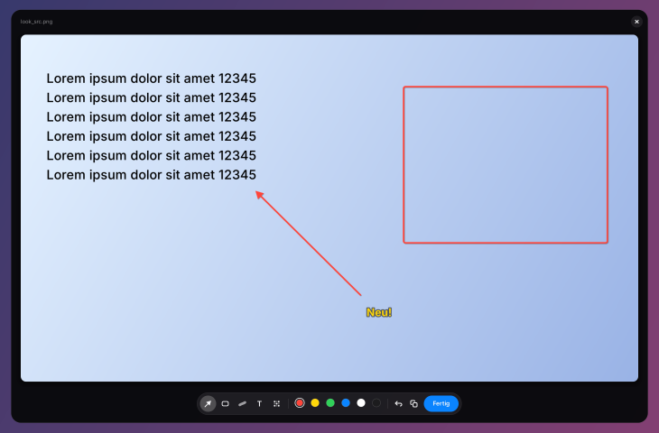
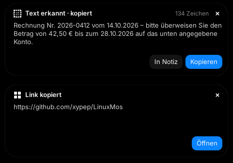
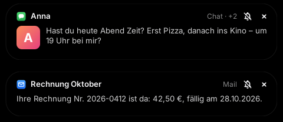
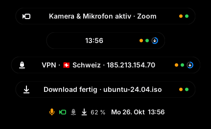

# LinuxMos – macOS-Look für Linux Mint Cinnamon (leichtgewichtig)

Die Linux-Mint-Version des Videos „Windows 27 Golden Gate“: Linux Mint sieht danach aus wie macOS, mit Ampel-Buttons, Glass-Dock, Top Bar, Widgets und Spotlight-Suche. Der Unterschied: **Es läuft im Leerlauf mit nahezu 0 % CPU**. Es gibt keinen Blur-Compositor, keine Dauer-Animationen und keine Hintergrund-Launcher.

> Getestet für **Linux Mint 22.x Cinnamon** (Basis Ubuntu 24.04). Andere Editionen (Xfce/MATE) werden nicht unterstützt.

---

## Inhalt

1. [Was du bekommst](#was-du-bekommst)
2. [Windows-Video → Linux Mint (Mapping)](#windows-video--linux-mint-mapping)
3. [Schnellinstallation](#schnellinstallation)
4. [Optionen](#optionen)
5. [Schritt für Schritt (manuell, wie im Video)](#schritt-für-schritt-manuell-wie-im-video)
6. [MosIsland (Dynamic Island)](#mosisland-dynamic-island)
7. [Aktualisieren](#aktualisieren)
8. [Performance – warum das hier nicht 80 % CPU frisst](#performance--warum-das-hier-nicht-80--cpu-frisst)
9. [Anpassen](#anpassen)
10. [Troubleshooting](#troubleshooting)
11. [Rückgängig machen](#rückgängig-machen)
12. [Credits & Lizenzen](#credits--lizenzen)

---

## Was du bekommst

- **Theme** – WhiteSur (GTK 3/4, Cinnamon-Shell, Fensterrahmen) mit macOS-Ampel-Buttons **links**
- **Icons & Cursor** – WhiteSur Icons und WhiteSur Cursors
- **Wallpaper** – WhiteSur Dark/Light (2K)
- **Top Bar** – Cinnamon-Panel oben (28 px), Logo-Menü, Uhr im macOS-Format („So. 25. Okt. 14:32“)
- **Dock** – Plank mit Glass-Theme und macOS-Zoom beim Hovern
- **Animationen** – schnelle Minimize-Animation Richtung Dock
- **Widgets** – große Desktop-Uhr und ein System-Widget (CPU/RAM/Disk/Akku, optional Wetter)
- **Spotlight** – `Super+Space` öffnet die rofi-Suche (Apps, Befehle, Fenster, Dateien)
- **MosIsland** *(optional, `--island`)* – Dynamic Island oben in der Mitte: Musik mit Synced Lyrics, Clipboard-Verlauf, Datei-Ablage, Aufgaben, Pomodoro, Wasser-Erinnerung, Wetter, Controls, Overlays, Screenshots mit Editor, Text & QR vom Bildschirm, Benachrichtigungen als Karte, Mikrofon-/Kamera-Punkt, VPN- und Download-Hinweise und ein Maskottchen → [Details](#mosisland-dynamic-island)
- **Update** – `./update.sh` holt die neue Version und aktualisiert alles, ohne deine Einstellungen anzufassen
- **Backup & Undo** – Timeshift-Snapshot (optional) und Sicherung aller geänderten Einstellungen

## Windows-Video → Linux Mint (Mapping)

| Im Video (Windows)                         | Hier (Linux Mint)                                     | Hintergrund-Last |
|--------------------------------------------|-------------------------------------------------------|------------------|
| Restore Point                              | Timeshift-Snapshot und dconf-Backup                   | –                |
| Windhawk UXTheme Hook + Theme              | WhiteSur GTK/Cinnamon/Metacity-Theme                  | 0                |
| Start Menu Styler / Notification Styler    | WhiteSur Cinnamon-Theme (Menü, Benachrichtigungen)    | 0                |
| Taskbar Styler (macOS 26 Clear Dock)       | **Plank** mit WhiteSur-Dock-Theme                     | ~0 %             |
| Dock Animation                             | Plank Zoom (150 %)                                    | nur beim Hovern  |
| macOS Minimize Animation (Genie)           | Cinnamon-Effekt „traditional“, Speed „fast“           | nur beim Minimieren |
| File Explorer Styler + Translucent Windows | Nemo mit WhiteSur-Theme (ohne Blur, absichtlich)      | 0                |
| Resource Redirect (macOS-Icons)            | WhiteSur Icon Theme                                   | 0                |
| Settings Styler                            | Cinnamon Settings übernehmen das GTK-Theme automatisch | 0                |
| Rainmeter Top Bar + Control Center         | Cinnamon-Panel oben (Sound, Netzwerk, Helligkeit)     | 0                |
| Rainmeter Clock / Big Sur Widgets          | **Conky** (Uhr + System-Widget)                       | ~0,03 %          |
| Raycast                                    | **rofi** (Spotlight-Theme)                            | 0 (nur wenn offen) |
| [Island](https://github.com/exuupery/island) / [Nusa](https://rama2555.github.io/nusa/) (Dynamic Island, Windows) | **MosIsland** (eigene Umsetzung, `--island`) | 0,1 % (gemessen) |

## Schnellinstallation

```bash
git clone https://github.com/xypep/LinuxMos.git
cd LinuxMos
./install.sh
```

- Das Script **nicht** mit `sudo` starten. Es fragt selbst nach dem Passwort (für `apt` und Timeshift).
- Danach **einmal ab- und wieder anmelden**.
- Dauer: ca. 3–5 Minuten (vor allem der Download der Icon- und Theme-Repos).

## Optionen

```bash
./install.sh --help
```

| Option              | Wirkung                                                  |
|---------------------|----------------------------------------------------------|
| `--light`           | Helles Design statt Dark Mode                            |
| `--minimal`         | Alle Animationen aus (Dock-Zoom, Fenster-Effekte)        |
| `--weather Berlin`  | Wetter im System-Widget (wttr.in, Update alle 30 min)    |
| `--no-widgets`      | Keine Conky-Widgets                                      |
| `--no-spotlight`    | Keine Spotlight-Suche                                    |
| `--firefox`         | Zusätzlich WhiteSur-Theme für Firefox                    |
| `--island`          | [MosIsland](#mosisland-dynamic-island) installieren (Opt-in) |
| `--snapshot`        | Timeshift-Snapshot ohne Nachfrage                        |
| `--no-snapshot`     | Keinen Timeshift-Snapshot                                |
| `-y`, `--yes`       | Alle Rückfragen automatisch mit „ja“ beantworten         |

Beispiel:

```bash
./install.sh --weather "Hamburg" --snapshot --island
```

`--weather` setzt den Ort für das Conky-Widget und für die MosIsland gleichzeitig.

Das Script ist **idempotent**: Du kannst es mehrfach ausführen, zum Beispiel um von Dark auf `--light` zu wechseln. Das Original-Backup wird dabei nicht überschrieben.

---

## Schritt für Schritt (manuell, wie im Video)

Alles hier macht `install.sh` automatisch. Die Anleitung ist für dich, wenn du verstehen willst, was passiert, oder lieber alles von Hand machst.

### 0. Sicherung anlegen (= Restore Point)

**Menu → Timeshift** öffnen, beim ersten Start den Assistenten durchgehen (Typ `RSYNC`) und dann **Create** klicken.

Per Terminal:

```bash
sudo timeshift --create --comments "Before LinuxMos"
```

### 1. Pakete installieren

```bash
sudo apt update
sudo apt install git curl plank conky-std rofi fonts-inter sassc libglib2.0-dev-bin libxml2-utils
```

### 2. Theme mit Ampel-Buttons (= UXTheme Hook + Windows-Theme)

```bash
mkdir -p ~/.cache/linuxmos && cd ~/.cache/linuxmos
git clone --depth 1 https://github.com/vinceliuice/WhiteSur-gtk-theme.git
cd WhiteSur-gtk-theme
./install.sh -c dark -o normal -l --round
```

Danach unter **System Settings → Themes**:

- `Applications`: **WhiteSur-Dark**
- `Window borders`: **WhiteSur-Dark**
- `Desktop`: **WhiteSur-Dark**

Die Buttons kommen nach links unter **System Settings → Windows → Titlebar → Buttons layout**: `Left`. Per Terminal:

```bash
gsettings set org.cinnamon.desktop.wm.preferences button-layout 'close,minimize,maximize:'
```

### 3. Icons und Cursor (= Resource Redirect)

```bash
cd ~/.cache/linuxmos
git clone --depth 1 https://github.com/vinceliuice/WhiteSur-icon-theme.git
git clone --depth 1 https://github.com/vinceliuice/WhiteSur-cursors.git
(cd WhiteSur-icon-theme && ./install.sh)
(cd WhiteSur-cursors && ./install.sh)
```

Dann unter **System Settings → Themes**: `Icons` → **WhiteSur-dark**, `Mouse Pointer` → **WhiteSur-cursors**.

### 4. Wallpaper

Die macOS-artigen Wallpaper liegen im Repo [WhiteSur-wallpapers](https://github.com/vinceliuice/WhiteSur-wallpapers), Ordner `2k/` oder `4k/`. Bild runterladen, dann **Rechtsklick auf den Desktop → Change Desktop Background**.

### 5. Top Bar (= Rainmeter Top Bar)

1. **Rechtsklick aufs Panel → Panel edit mode** aktivieren.
2. **Rechtsklick → Move** und das Panel nach **oben** ziehen.
3. **Rechtsklick → Panel settings → Panel height**: `28`.
4. Das Applet **Grouped window list** entfernen, denn laufende Apps zeigt jetzt das Dock.
5. **Rechtsklick aufs Menü-Icon → Configure → Menu icon**: `start-here-symbolic` (zeigt das Logo aus dem WhiteSur-Icon-Theme), Text leer lassen.
6. **Rechtsklick auf die Uhr → Configure → Use a custom date format**: `%a %e. %b  %H:%M`.

Das „Control Center“ aus dem Video sind hier die Applets für **Sound**, **Network** und **Power** (Helligkeit). Sie sind schon in der Top Bar.

### 6. Dock (= Taskbar Styler + Dock Animation)

1. Plank starten: `plank &`
2. Das Dock-Theme verlinken:

   ```bash
   mkdir -p ~/.local/share/plank/themes/LinuxMos-Dark
   cp ~/.themes/WhiteSur-Dark/plank/dock.theme ~/.local/share/plank/themes/LinuxMos-Dark/
   ```

3. `Ctrl` + Rechtsklick aufs Dock → **Preferences**:
   - `Theme`: **LinuxMos-Dark**
   - `Hide`: **Intelligent**
   - `Icon Size`: `48`
   - `Zoom`: an, `150 %` (die macOS-Vergrößerung)
4. Autostart: **System Settings → Startup Applications → + → Choose application → Plank**.

### 7. Animationen (= Genie-Animation)

**System Settings → Effects**:

- `Minimizing windows`: **Traditional** (schrumpft ins Dock, die leichte Variante von „Genie“)
- `Window animation speed`: **Faster** (das Video nennt die Mac-Animationen selbst „überdramatisch“)

Ein echtes Genie gibt es unter Cinnamon nicht. Dafür bräuchte man Compiz, und das ist genau die Art Effekt-Overhead, die wir vermeiden.

### 8. Widgets (= Rainmeter + JaxCore + Big Sur Widgets)

```bash
mkdir -p ~/.config/linuxmos/conky
cp config/conky/clock.conf ~/.config/linuxmos/conky/
# stats.conf.in ist ein Template – am einfachsten über install.sh erzeugen
conky -d -c ~/.config/linuxmos/conky/clock.conf
```

- **clock.conf** – große Desktop-Uhr im macOS-Stil, Update alle 5 s
- **stats.conf** – Glass-Widget oben rechts (CPU, RAM, Disk, Akku, optional Wetter), Update alle 3 s

Steuern mit `linuxmos-widgets start|stop|restart`.

### 9. Spotlight (= Raycast)

```bash
rofi -show drun -theme ~/.config/linuxmos/rofi/spotlight.rasi
```

Tastenkürzel: **System Settings → Keyboard → Shortcuts → Custom Shortcuts → Add custom shortcut**. Als Command `~/.local/bin/linuxmos-spotlight` eintragen, als Shortcut `Super+Space`.

Achtung: `Super+Space` ist in Cinnamon standardmäßig „Switch input source“ (Tastaturlayout wechseln). `install.sh` gibt das Kürzel frei. Der Layout-Wechsel geht dann über `Shift+Super+Space` oder `XF86Keyboard`.

Bedienung in der Suche:

- `Shift+→`: Modus wechseln (Apps → Run → Fenster → Dateien)
- `Esc` oder `Super+Space`: Suche schließen

> Rechner, Einheiten, Währungen und Websuche stecken in der [Command Bar der MosIsland](#suche-command-bar) (`Ctrl+Alt+Space`, mit `--island`). Für Erweiterungen à la Raycast gibt es [Ulauncher](https://ulauncher.io/), der läuft aber dauerhaft im Hintergrund (~60–100 MB RAM). rofi braucht 0 MB, solange es nicht offen ist.

---

## MosIsland (Dynamic Island)

Eine schwarze Pille oben in der Mitte, direkt unter der Top Bar. Sie zeigt, was gerade passiert, und klappt zu einer Toolbox auf, wenn du mit der Maus drüberfährst. Inspiriert von [Island](https://github.com/exuupery/island), [Nusa](https://rama2555.github.io/nusa/) (beide Windows) und Apples Dynamic Island.

> **Kein Port, sondern eine eigene Umsetzung.** Island und Nusa sind Closed-Source-Apps für Windows: In ihren Repos liegen nur README, Screenshots bzw. die Website, eine Lizenz gibt es nicht. MosIsland ist von Grund auf für Linux Mint Cinnamon geschrieben (Python + GTK3) und nutzt weder Code noch Grafiken der Originale.

```bash
./install.sh --island            # zusammen mit allem anderen
./install.sh --island --weather Berlin
```

### Die Pille lebt

 

Eingeklappt zeigt sie immer das Wichtigste (Priorität von oben nach unten):

| Zustand          | Inhalt                                                        |
|------------------|---------------------------------------------------------------|
| Karte            | Größer als die Pille, mit Text und Buttons: **Benachrichtigungen**, **erkannter Text** (`Ctrl+Alt+O`), **QR-Code** (`Ctrl+Alt+Q`) |
| Live-Aktivität   | **Lautstärke** & **Helligkeit** (ersetzt Cinnamons OSD), **Feststelltaste**, **Tastatur-Sprache**, **Ladegerät eingesteckt**, **WLAN weg / wieder da**, **Kopfhörer verbunden (mit Akku)**, Datei abgelegt, Regen in etwa 1 Std., Aufgabe fällig, Wasser-Erinnerung, Timer/Pomodoro, **Mikrofon/Kamera an**, **VPN an/aus**, **Download gestartet/fertig** |
| Timer            | Countdown live in der Pille (Timer, Fokus oder Pause)          |
| Lyrics           | Die Zeile, die gerade gesungen wird (optional)                 |
| Musik            | Cover + Titel (Spotify, Firefox/YouTube, VLC, Rhythmbox, … über MPRIS) |
| Minimal-Notch    | Nur ein dünner Strich (Alerts, Lyrics und Hover gehen trotzdem) |
| Maskottchen      | Bist du weg, ruht die Uhr und zwei Augen kommen raus. Sie dösen nach 5 min ein und winken, wenn du zurückkommst. |
| Leerlauf         | Uhrzeit, Temperatur, Akku                                      |


Manche Hinweise sind klickbar: Ein Klick auf die Wasser-Erinnerung trägt eine Portion ein, „Pause vorbei“ startet die nächste Fokus-Runde, und eine fällige Aufgabe öffnet die Aufgabenliste.

### Aufgeklappt: neun Tabs

| Tab | Inhalt |
|---|---|
| 🔍 | **Suche** – die [Command Bar](#suche-command-bar): Apps, Dateien, Rechner, Einheiten, Währungen und Websuche in einem Feld (`Ctrl+Alt+Space`). |
|  | **Jetzt** – Cover, Titel, ⏮ ⏯ ⏭, **auf den Fortschrittsbalken klicken zum Spulen**; darunter Wetter, Timer, Akku |
|  | **Synced Lyrics** – Lyrics-Knopf im Player: Jede Zeile leuchtet auf, während sie gesungen wird. **Klick auf eine Zeile springt dorthin.** Optional zeigt die eingeklappte Pille die aktuelle Zeile. Quelle: [LRCLIB](https://lrclib.net) (kostenlos, ohne Konto). |
|  | **Zwischenablage** – Verlauf (Text + Bilder) mit Suche und Pins. **Ein Klick fügt den Eintrag direkt ins Fenster ein, in dem du gerade tippst.** Terminals bekommen automatisch `Ctrl+Shift+V`. Passwörter aus KeePassXC & Co. werden nie gespeichert. Optional werden nicht angepinnte Einträge nach X Minuten automatisch gelöscht (Tray-Menü). |
|  | **Ablage** – Dateien auf die Insel ziehen, sie warten dort, bis du sie in ein anderes Fenster ziehst (einzeln oder „Alle ziehen“). Doppelklick öffnet. Die Dateien bleiben, wo sie sind, gespeichert wird nur der Pfad. |
|  | **Aufgaben** – To-do-Liste mit Erinnerung: Aufgabe eintippen, Zeit dazu (`14:30`, `9`, `2pm`, `in 20 min`, `in 2 h`), und die Insel tippt dir zur Zeit auf die Schulter. Erledigtes von gestern räumt sich selbst auf. |
|  | **Notiz & Fokus** – Notiz, die sich selbst speichert. **Pomodoro**: 25 min Fokus, dann startet die Pause automatisch (jede 4. ist 15 min lang), dazu ein leiser Gong. Dazu normale Timer. |
|  | **Wasser** – Portion (Flasche/Glas) und Tagesziel einstellen, mit einem Klick trinken, Diagramm pro Stunde. Erinnert nur in deinen aktiven Stunden und nur, solange das Ziel nicht erreicht ist. |
|  | **Wetter** – jetzt, die nächsten 24 Stunden und 7 Tage. Daten von [MET Norway](https://www.met.no/en), ohne API-Key und ohne Konto; Warnung kurz bevor es zu regnen beginnt. |
|  | **Steuerung** – WLAN, Bluetooth, Nicht stören, Dark Mode (schaltet das ganze WhiteSur-Theme um), Mikro aus, Lautstärke, Helligkeit (Laptop), Screenshot, Sperren. Ruhezustand/Neustart/Aus wollen zweimal geklickt werden. |

#### Suche (Command Bar)

`Ctrl+Alt+Space` (oder Klick auf die Lupe ganz links) öffnet die Insel mit einem Eingabefeld. Einfach lostippen, die Treffer kommen beim Tippen:

| Eingabe                          | Treffer                                                         |
|----------------------------------|-----------------------------------------------------------------|
| `fire`, `text`, `einst`          | Apps (Name, Beschreibung, Stichwörter, in der Systemsprache); oft gestartete rücken nach oben |
| `rechnung`, `urlaub 2026`        | Dateien und Ordner: zuletzt benutzte zuerst, dann alles im Home-Ordner (mehrere Wörter = alle müssen im Namen stehen) |
| `12*7`, `2^10`, `sqrt(2)`, `50*20%`, `(3+4)/2` | Rechner, auch mit `,` als Komma; `sin cos tan ln log exp abs round floor ceil pi e` |
| `5 km in mi`, `100 f in c`, `1 GiB in MB`, `60 mph in km/h`, `2 h in min`, `3 m2 in sqft` | Einheiten: Länge, Gewicht, Volumen, Fläche, Temperatur, Zeit, Daten, Geschwindigkeit |
| `20 usd in eur`, `$20 in €`, `100 franken nach euro` | Währungen mit den EZB-Referenzkursen |
| `github.com`                     | „Website öffnen“                                                 |
| alles                            | als letzter Treffer: Websuche in der eingestellten Suchmaschine |

| Taste          | Wirkung                                                                   |
|----------------|---------------------------------------------------------------------------|
| `↑` / `↓`      | Treffer wählen                                                            |
| `Enter`/Klick  | App starten, Datei/Ordner/Website öffnen, Rechen-Ergebnis kopieren        |
| `Ctrl+Enter`   | Rechen-Ergebnis direkt ins vorige Fenster einfügen, Datei im Ordner zeigen |
| `Esc`          | Zuklappen (die letzte Eingabe bleibt markiert stehen, Tippen ersetzt sie)  |

Leeres Feld = deine meistgestarteten Apps. Die rofi-Suche (`Super+Space`) bleibt unverändert, für Fenster und die ganze Platte ist sie die bessere Wahl.

**Dateien:** Beim ersten Tippen liest ein Thread einmal den Home-Ordner ein (bis 5 Ebenen, ohne versteckte Ordner wie `.cache`, ohne `node_modules`, `venv`, `snap`, höchstens 20 000 Einträge, typisch < 1 s). Die Liste ist kompakt (~1 MB) und wird 3 Minuten nach der letzten Suche wieder verworfen; nach 10 Minuten wird neu eingelesen. Kein Indexdienst, nichts läuft im Hintergrund.

**Währungen:** Die Kurse holt die Insel bei api.frankfurter.dev (die Referenzkurse der EZB, ohne Konto) – nur, wenn du eine Währungsumrechnung tippst, und höchstens alle 12 Stunden (Cache in `~/.cache/linuxmos/island/rates.json`). Abschalten: Tray → „Suche“ → „Währungen“.

**Suchmaschine:** Tray → „Suche“ → „Websuche mit“: DuckDuckGo (Standard), Google, Startpage, Ecosia, Bing, Brave Search – oder eine eigene URL in `config.json`, z. B. `"command_bar_engine": "https://de.wikipedia.org/w/index.php?search=%s"`.

#### Screenshots

`Ctrl+Alt+S` nimmt einen Bereich auf (ziehen, oder ein Fenster anklicken), `Ctrl+Alt+Shift+S` den ganzen Monitor, auf dem die Maus steht. Die Insel blendet sich dafür kurz aus. Das Bild liegt sofort in der Zwischenablage (und im Clipboard-Verlauf) und als PNG in `~/Bilder/LinuxMos`. Die Insel meldet „Screenshot kopiert · Klick = bearbeiten“.

Der Klick öffnet den **Markup-Editor** – schwarz und abgerundet wie die Insel, unten eine schwebende Pille mit Werkzeugen, Farben, Rückgängig, Kopieren und „Fertig“. Verschieben: an einer freien Stelle (Rand, Dateiname) ziehen.



| Werkzeug   | Taste | Wirkung                                                         |
|------------|-------|-----------------------------------------------------------------|
| Pfeil      | `A`   | Ziehen von hinten nach vorne zur Spitze                          |
| Rechteck   | `R`   | Rahmen ziehen                                                   |
| Marker     | `M`   | Freihand, wie ein Textmarker (der Text darunter bleibt lesbar)   |
| Text       | `T`   | Klicken, tippen, `Enter`                                        |
| Verpixeln  | `B`   | Rahmen über Passwörter, Namen, Adressen ziehen – grobe Blöcke statt Weichzeichner, damit sich nichts zurückrechnen lässt |
| Text       | `O`   | Button neben Rückgängig: erkennt den Text der Aufnahme und kopiert ihn (siehe „Text & QR-Codes“) |

`1`–`6` wählt die Farbe, `Ctrl+Z` macht rückgängig, `Ctrl+C` kopiert die markierte Fassung, `Ctrl+S` bzw. „Fertig“ speichert sie (überschreibt die Aufnahme), kopiert sie ebenfalls und schließt. `Esc` oder ✕ schließt den Editor; gibt es ungespeicherte Markierungen, wird ✕ rot („Verwerfen?“) und erst der zweite Druck verwirft – wie bei Neustart/Aus in der Insel.

Abbrechen während der Auswahl: `Esc` oder denselben Hotkey nochmal drücken. Läuft die Insel nicht, funktionieren die Hotkeys trotzdem: dann übernimmt ein kurzlebiger Prozess, der Hinweis kommt als Benachrichtigung mit „Bearbeiten“-Knopf.

#### Text & QR-Codes vom Bildschirm

`Ctrl+Alt+O` – Bereich aufziehen, tesseract erkennt den Text (Deutsch + Englisch, komplett lokal). Er liegt sofort in der Zwischenablage, die Insel zeigt ihn als **Karte**: die ersten Zeilen, die Zeichenzahl, „In Notiz“ (hängt ihn an die Notiz im Tab „Notiz & Fokus“) und „Kopieren“. Die Karte verschwindet nach ein paar Sekunden von selbst und bleibt, solange die Maus darauf liegt; ✕ schließt sie sofort. Kleine Bereiche werden vor der Erkennung doppelt so groß gerechnet, das hilft bei kleiner UI-Schrift deutlich.

Die Zeilen eines Absatzes werden zu einer Zeile zusammengefügt, Trennstriche am Zeilenende verschwinden („fort-/zufahren“ → „fortzufahren“, „E-/Mail“ bleibt „E-Mail“), Absätze und Aufzählungen bleiben erhalten. Wer den Text zeilengenau braucht (Code, Tabellen): Tray → „Text & QR“ → „Zeilenumbrüche behalten“.

`Ctrl+Alt+Q` – liest QR-Codes und Barcodes (EAN, Code 128 …) im Bereich. Der Inhalt landet in der Zwischenablage; bei einem Link bietet die Karte „Öffnen“, bei einem WLAN-Code („WIFI:…“) wird das Passwort kopiert und „Verbinden“ angeboten (per `nmcli`). Mehrere Codes im Bereich werden zeilenweise kopiert.



Im **Screenshot-Editor** macht der Button „Text“ (oder `O`) dasselbe mit der ganzen Aufnahme – erkannt wird das Original ohne Markierungen.

Andere Sprachen: Sprachpaket installieren und in `config.json` ergänzen, z. B. `sudo apt install tesseract-ocr-fra` und `"ocr_languages": "deu+eng+fra"` (mehr Sprachen = etwas langsamer). Ohne laufende Insel funktionieren beide Hotkeys auch, das Ergebnis kommt dann als Benachrichtigung.

#### Benachrichtigungen

Jede Benachrichtigung (Chat, Mail, Browser, Kalender, `notify-send` …) erscheint als **Karte** oben auf der Insel: App-Icon, Titel, Text (bis zu vier Zeilen) und – wenn die App eins mitschickt – ein Bild wie der Avatar des Absenders oder das Album-Cover. Daneben stehen der App-Name und, wenn inzwischen weitere kamen, ein Zähler: Die neueste Benachrichtigung ersetzt die angezeigte sofort, „+2“ heißt „zwei davor hast du verpasst“. Die Karte ist so hoch wie ihr Text, verschwindet nach ~7 Sekunden (oder so lange, wie die App es wünscht, 4–15 s) und bleibt, solange die Maus darauf liegt. Kritische Meldungen (z. B. Akku fast leer) bleiben, bis du sie schließt.



| Klick auf …    | Wirkung                                                          |
|----------------|------------------------------------------------------------------|
| die Karte      | Holt die App nach vorne (das Fenster des Absenders, auch auf einer anderen Arbeitsfläche); läuft sie nicht, wird sie gestartet |
| 🔕             | Benachrichtigungen dieser App nicht mehr auf der Insel zeigen (rückgängig im Tray-Menü) |
| ✕              | Karte schließen                                                  |

**Wie das funktioniert:** Cinnamon bleibt der Benachrichtigungs-Dienst (`org.freedesktop.Notifications`) – die Insel ersetzt ihn nicht, sondern liest per D-Bus-Monitor nur mit. Damit nichts doppelt erscheint, schaltet sie Cinnamons eigene Banner ab, solange die Karten an sind; Cinnamon legt die Benachrichtigungen dann still im **Benachrichtigungs-Applet** ab. Dort bleibt der Verlauf, und dort sind auch die Buttons der Benachrichtigungen („Antworten“ …), die nur Cinnamon auslösen kann. Beendest du die Insel oder schaltest die Karten aus, kommen Cinnamons Banner zurück.

**Nicht stören** (Steuerung-Tab oder Tray) gilt dann für die Insel: keine Karten, nur kritische Meldungen kommen durch, alles andere landet im Applet. War Cinnamons „Nicht stören“ beim ersten Start schon an, übernimmt die Insel das. Schaltest du in Cinnamons Einstellungen die Benachrichtigungen wieder ein, versteht die Insel das als „Nicht stören aus“.

Ausblenden lassen sich Apps per 🔕 auf der Karte, im Tray-Menü unter „Benachrichtigungen“ (dort stehen die zuletzt gesehenen Apps zum Abhaken) oder in `config.json` (`notifications_exclude`). Eigene Meldungen der Insel (Timer, Erinnerungen) zeigt sie weiter als Live-Aktivität, nicht als Karte.

#### Mikrofon, Kamera, VPN, Downloads



Rechts in der eingeklappten Pille sitzen kleine Live-Punkte – in jedem Zustand außer bei einer Karte, die Pille wird dafür etwas breiter:

| Punkt           | Bedeutung                                                     |
|-----------------|---------------------------------------------------------------|
| 🟠 orange        | Eine App nimmt mit dem Mikrofon auf (grau = stummgeschaltet)  |
| 🟢 grün          | Eine App nutzt die Kamera                                     |
| Ring mit Pfeil  | Ein Download läuft; mit Prozent, wenn der Browser ihn meldet (Chromium/Chrome) |

Wenn es losgeht, sagt die Insel kurz, wer: „Mikrofon aktiv · Firefox“, „Kamera aktiv · Zoom“. Aufgeklappt stehen in der Kopfzeile neben der Uhr die Details (Maus drauf zeigt die Apps): ein **Mikro-Button**, der alle gerade aufnehmenden Mikrofone stumm- bzw. wieder lautschaltet, die Kamera, ein VPN-Symbol und der Download mit Prozent oder Größe – Klick öffnet den Download-Ordner. Ist ein Download fertig, öffnet ein Klick auf „Download fertig“ den Dateimanager mit der Datei markiert.

**VPN:** Beim Verbinden und Trennen erscheint ein kurzer Hinweis mit dem Namen der Verbindung. Erkannt werden VPNs aus dem NetworkManager (OpenVPN, WireGuard, …) und die tun-/WireGuard-Schnittstellen anderer VPN-Apps (Mullvad, `wg-quick`, `openvpn` auf der Konsole). Mit Tray → „Live-Hinweise“ → „VPN: Land & IP“ fragt die Insel nach dem Verbinden einmal ipinfo.io und zeigt Land und Ausgangs-IP, z. B. „VPN · 🇨🇭 Schweiz · 185.213.154.70“. Das ist eine Anfrage an einen fremden Dienst und deshalb standardmäßig aus.

**Wie das ohne Dauerlast geht:** Das Mikrofon kommt aus demselben `pactl subscribe`, das schon die Lautstärke liefert; nur bei einem Ereignis werden die Aufnahme-Streams einmal abgefragt. Pegelanzeigen (pavucontrol) und Aufnahmen vom Lautsprecher-Monitor zählen nicht. Die Kamera meldet der Kernel per inotify, sobald jemand `/dev/video*` öffnet oder schließt; erst dann sucht die Insel in `/proc` nach der App – und auch erst nach einer Sekunde, damit kurzes Antasten (PipeWire, Browser beim Auflisten der Kameras) keinen Punkt auslöst. Downloads beobachtet inotify im Download-Ordner, höchstens einmal pro Sekunde.

### Tray-Menü

Das MosIsland-Icon liegt in der Top Bar neben der Uhr (Rechtsklick):

| Schalter                          | Wirkung                                                         |
|-----------------------------------|-----------------------------------------------------------------|
| Mit Cinnamon starten              | Autostart an/aus                                                |
| Maskottchen                       | Augen im Leerlauf an/aus                                        |
| Minimal-Notch                     | Eingeklappt nur ein dünner Strich, z. B. für Laptops mit dickem Rand oben oder damit Browser-Tabs frei bleiben |
| Lautstärke & Helligkeit anzeigen  | MosIsland-Overlays statt Cinnamons eigenem OSD (aus = Cinnamon-OSD zurück) |
| Zwischenablage automatisch leeren | Nicht angepinnte Einträge nach 15 min, 1 h oder 24 h löschen (Standard: nie) |
| Suche                             | Suche öffnen, „Dateien durchsuchen“, „Währungen (fragt frankfurter.dev)“, „Websuche mit“ (Suchmaschine) |
| Screenshot                        | Bereich/Bildschirm aufnehmen, „Im Ordner speichern“, „Editor sofort öffnen“, Ordner öffnen |
| Text & QR                         | Text erkennen, QR-Code lesen, „Zeilenumbrüche behalten“, „Links aus QR-Codes sofort öffnen“ |
| Benachrichtigungen                | „Auf der Insel anzeigen“ (aus = Cinnamons Banner zurück), „Nicht stören“, zuletzt gesehene Apps zum Ausblenden |
| Live-Hinweise                     | „Mikrofon & Kamera“, „VPN-Status“, „VPN: Land & IP (fragt ipinfo.io)“, „Download-Fortschritt“ |
| Sprache / Language                | Automatisch (Systemsprache), Deutsch oder English – die Insel startet dabei kurz neu |
| Über MosIsland · Beenden          |                                                                 |

Ein Linksklick aufs Icon klappt die Insel auf.

### Bedienung

| Aktion                        | Wie                                                     |
|-------------------------------|---------------------------------------------------------|
| Aufklappen                    | Maus auf die Pille (oder klicken)                       |
| Zuklappen                     | Maus weg, `Esc`                                         |
| MosIsland öffnen/schließen    | `Ctrl+Alt+I`                                            |
| Suche (Command Bar)           | `Ctrl+Alt+Space` → tippen → `↑`/`↓` → `Enter`           |
| Zwischenablage                | `Ctrl+Alt+V` → tippen zum Suchen → `Enter` fügt ein     |
| Screenshot Bereich / Bildschirm | `Ctrl+Alt+S` / `Ctrl+Alt+Shift+S`                     |
| Text erkennen / QR-Code lesen | `Ctrl+Alt+O` / `Ctrl+Alt+Q`                             |
| Lautstärke                    | Mausrad auf der eingeklappten Pille                     |
| Dateien ablegen               | Datei aus Nemo/Desktop auf die Pille ziehen             |
| Spulen                        | Klick auf den Fortschrittsbalken oder eine Lyrics-Zeile |

Die Insel **stiehlt nie den Fokus**: Beim Hovern bleibt dein Fenster aktiv. Den Fokus nimmt sie sich nur, wenn du in ein Textfeld klickst oder sie per Tastenkürzel öffnest. Danach gibt sie ihn zurück. Vor Vollbild-Apps (Videos, Spiele) tritt sie automatisch zurück.

Per Terminal steuern:

```bash
linuxmos-island --toggle
linuxmos-island --tab todo          # search|home|clipboard|shelf|todo|note|water|weather|controls
linuxmos-island --set-city "München"
linuxmos-island --quit
```

### Einstellungen

Die meisten Schalter liegen im Tray-Menü bzw. im Wasser-Tab (⚙). Alles steht außerdem in `~/.config/linuxmos/island/config.json` (nach dem Ändern: `linuxmos-island --quit && linuxmos-island &`):

| Key                  | Default   | Bedeutung                                                    |
|----------------------|-----------|--------------------------------------------------------------|
| `city`               | `""`      | Wetter-Ort (wird einmalig über OpenStreetMap gesucht)         |
| `language`           | `"auto"`  | Oberfläche: `auto` (Deutsch bei `de_*`-Systemsprache, sonst Englisch), `de`, `en` |
| `offset_y`           | `6`       | Abstand zur Top Bar in px                                    |
| `compact_when_idle`  | `false`   | Minimal-Notch                                                |
| `mascot`             | `true`    | Maskottchen                                                  |
| `osd`                | `true`    | Lautstärke-/Helligkeits-Overlays                             |
| `lyrics_in_pill`     | `false`   | Aktuelle Lyrics-Zeile in der eingeklappten Pille             |
| `clipboard_limit`    | `50`      | Einträge im Verlauf (angepinnte zählen nicht)                 |
| `clipboard_autodelete_min` | `0` | Nicht angepinnte Einträge nach so vielen Minuten löschen (`0` = nie) |
| `screenshot_save`    | `true`    | Screenshots zusätzlich als PNG ablegen (`false` = nur Zwischenablage) |
| `screenshot_dir`     | `""`      | Ordner für Screenshots (leer = `~/Bilder/LinuxMos`)           |
| `screenshot_open_editor` | `false` | Editor direkt nach der Aufnahme öffnen                      |
| `ocr_languages`      | `"deu+eng"` | tesseract-Sprachen für die Texterkennung, mit `+` verbunden |
| `ocr_keep_linebreaks` | `false`  | Erkannten Text zeilengenau lassen (statt Absätze zusammenzufügen) |
| `qr_open_links`      | `false`   | Links aus QR-Codes sofort öffnen statt „Öffnen“-Button       |
| `notifications_on_island` | `true` | Benachrichtigungen als Karte auf der Insel (Cinnamons Banner sind solange aus) |
| `notifications_dnd`  | `false`   | „Nicht stören“ der Insel (nur kritische Meldungen als Karte)  |
| `notifications_exclude` | `[]`   | Apps, die nie als Karte erscheinen: Namen wie auf der Karte oder Desktop-IDs, z. B. `["Spotify", "org.telegram.desktop"]` |
| `privacy_indicator`  | `true`    | Orangen (Mikrofon) und grünen (Kamera) Punkt zeigen           |
| `vpn_status`         | `true`    | Hinweis beim Verbinden/Trennen eines VPN                      |
| `vpn_lookup`         | `false`   | Land und IP des VPN bei ipinfo.io abfragen (externe Anfrage)   |
| `downloads_progress` | `true`    | Download-Ring und „Download fertig“                           |
| `downloads_dir`      | `""`      | Beobachteter Download-Ordner (leer = `~/Downloads` bzw. der XDG-Download-Ordner) |
| `command_bar_engine` | `"duckduckgo"` | Suchmaschine der Command Bar: `duckduckgo`, `google`, `startpage`, `ecosia`, `bing`, `brave` oder eine URL mit `%s` |
| `command_bar_files`  | `true`    | Dateien in der Command Bar suchen (zuletzt benutzte + Home-Ordner) |
| `command_bar_currency` | `true`  | Währungen umrechnen (EZB-Kurse über api.frankfurter.dev, nur beim Tippen einer Umrechnung) |
| `water_portion_ml` / `water_goal_ml` | `250` / `2000` | Portion und Tagesziel                     |
| `water_start` / `water_end` | `09:00` / `21:00` | Aktive Stunden für Erinnerungen                     |
| `water_interval_min` | `60`      | Erinnerung frühestens so lange nach dem letzten Schluck       |
| `water_reminders`    | `true`    | Wasser-Erinnerungen an/aus                                   |

Alle Daten (Notiz, Aufgaben, Wasser-Log, Verlauf, Ablage) liegen nur lokal in `~/.local/share/linuxmos/island/`. Es gibt kein Konto und kein Tracking. Ins Netz gehen nur der Wetter-Abruf (MET Norway, nur die Koordinaten) und die Lyrics-Suche (LRCLIB: Titel, Künstler, Länge), und die nur, wenn du die Lyrics nutzt. Mit `vpn_lookup` kommt nach jedem VPN-Verbinden eine Anfrage an ipinfo.io dazu (sieht die Ausgangs-IP des VPN). Die Command Bar fragt api.frankfurter.dev nach Wechselkursen, wenn du eine Währungsumrechnung tippst (höchstens alle 12 Stunden), und schickt deine Eingabe nur bei `Enter` auf „im Web suchen“ an die Suchmaschine. Gespeichert wird nur, wie oft du welche App über die Suche gestartet hast (`command.json`).

### Performance

| Zustand                                   | CPU (gemessen unter Cinnamon 6, 20 s) |
|-------------------------------------------|---------------------------------------|
| Eingeklappt, Musik läuft, alle Dienste an | 0,1–0,15 %                            |
| Lyrics-Zeile läuft in der Pille mit       | 0,15 %                                |
| Leerlauf (Uhr)                            | 0,0–0,1 %                             |

Möglich wird das, weil es keinen Polling-Loop gibt. Jede Quelle meldet sich von selbst:

| Was                    | Woher                                                         |
|------------------------|---------------------------------------------------------------|
| Musik                  | MPRIS-Signale (D-Bus); die Position rechnet eine lokale Uhr hoch, statt jede Sekunde nachzufragen |
| Lyrics                 | Ein Timer schläft genau bis zum Beginn der nächsten Zeile      |
| Lautstärke             | `pactl subscribe` (blockiert, bis sich etwas ändert)           |
| Helligkeit             | Signal des Cinnamon-Settings-Daemons                          |
| Feststelltaste/Sprache | XKB-Events bzw. gsettings                                      |
| Akku, WLAN, Kopfhörer  | UPower, NetworkManager, BlueZ (D-Bus-Signale)                  |
| Maskottchen            | Muffins IdleMonitor (D-Bus)                                    |
| Aufgaben, Wasser       | Ein einziger Timer bis zur nächsten fälligen Erinnerung        |
| Screenshots            | Nur auf Hotkey; der Editor wird erst beim ersten Öffnen geladen |
| Text & QR              | Nur auf Hotkey; tesseract/zbarimg laufen als eigener Prozess und beenden sich danach |
| Suche (Command Bar)    | Wird erst beim ersten Öffnen gebaut; sucht nur beim Tippen. Die Dateiliste entsteht einmal in einem Thread und wird 3 min nach der letzten Suche verworfen |
| Benachrichtigungen     | D-Bus-Monitor (`BecomeMonitor`) auf genau drei Nachrichtentypen – meldet sich nur, wenn eine Benachrichtigung kommt |
| Mikrofon               | Dasselbe `pactl subscribe` wie die Lautstärke; Abfrage der Streams nur bei einem Ereignis |
| Kamera                 | inotify auf `/dev/video*` (öffnen/schließen) und `/dev` (Kamera eingesteckt); `/proc`-Suche nur danach |
| VPN                    | NetworkManager-Signale (aktive Verbindungen, Geräte)            |
| Downloads              | inotify auf den Download-Ordner, max. 1 Update/s; nur während eines Downloads alle 15 s ein Blick auf hängende |
| Uhr                    | Einmal pro Minute                                              |

Gezeichnet wird nur, während sich etwas bewegt: beim Auf- und Zuklappen (~240 ms) oder beim Blinzeln des Maskottchens (~180 ms alle paar Sekunden).

**RAM: ~115 MB.** Ehrlich gesagt ist das der größte Posten. Er kommt fast komplett von Python + GTK3 selbst: Ein leeres GTK-Fenster in Python braucht schon ~93 MB. Nusa schafft ~30 MB, weil es in Rust geschrieben ist. Dafür braucht MosIsland keinen Compiler und lässt sich direkt anpassen. Die Command Bar kostet nichts, bis du sie zum ersten Mal öffnest, danach ~5 MB (gemessen unter Xvfb: 113,7 → 118,8 MB, mit 13 000 Dateien im Home-Ordner).

### Was nicht dabei ist

KI-Chat, Bildschirmaufnahme (Video), die „Ferrofluid“-Animation und 25 Charaktere (bewusst weggelassen, weil sie dauerhaft CPU kosten), Antworten direkt aus der Benachrichtigungs-Karte. Neben der eigenen [Command Bar](#suche-command-bar) bleibt die [Spotlight-Suche](#9-spotlight--raycast) mit rofi. Läuft nur unter X11, dem Standard bei Linux Mint Cinnamon.

---

## Aktualisieren

```bash
cd LinuxMos
./update.sh --check       # gibt es etwas Neues?
./update.sh               # aktualisieren
```

`update.sh` macht Folgendes:

1. Es holt die neue LinuxMos-Version (`git pull`) und startet sich danach mit der neuen Fassung selbst neu.
2. Es installiert nur neue Abhängigkeiten nach (kein apt-Lauf, wenn nichts fehlt).
3. Es lädt die WhiteSur-Themes neu (`--no-themes` überspringt das).
4. Es aktualisiert MosIsland, Tools und Skripte und startet die MosIsland neu.

**Deine Einstellungen bleiben**: Panel, Dock, Widget-Positionen, MosIsland-Daten, Wetter-Ort und Tray-Schalter fasst es nicht an. Die Optionen von damals (`--light`, `--island`, …) merkt sich `install.sh` in `~/.local/share/linuxmos/install.conf`.

| Option          | Wirkung                                                          |
|-----------------|------------------------------------------------------------------|
| `--check`       | Nur anzeigen, ob es Updates gibt (mit Änderungsliste)              |
| `--no-themes`   | Themes nicht neu laden (schneller)                                |
| `--full`        | Zusätzlich das Design neu anwenden, wie bei der Installation (setzt Panel/Dock/Effekte zurück auf LinuxMos-Standard) |

Hast du im Repo selbst Dateien geändert, überspringt `update.sh` den `git pull` und sagt dir das. Wurde LinuxMos als ZIP heruntergeladen statt per `git clone`, lädst du die neue Version manuell herunter und startest danach `./update.sh`.

---

## Performance – warum das hier nicht 80 % CPU frisst

### Typische CPU-Fresser bei macOS-Setups unter Linux

| Ursache                                          | Was LinuxMos stattdessen macht                         |
|--------------------------------------------------|--------------------------------------------------------|
| Compositor mit Blur (picom `dual_kawase`, KWin-Blur) | Kein Blur. Transparenz kommt nur aus dem Theme (statisch) |
| Conky mit Lua/Cairo und `update_interval 0.5`    | `conky-std` ohne Lua, Update alle 3–5 s                |
| Cinnamon-Desklets (laufen im Cinnamon-Prozess)   | Conky als eigener, winziger Prozess                    |
| Dock-Animationen in Endlosschleife               | Plank animiert nur beim Hovern oder Starten            |
| Launcher-Daemons (Ulauncher, Albert)             | rofi startet erst auf Tastendruck                      |
| Wetter-Widget, das jede Sekunde pollt            | `curl` alle 30 Minuten                                 |

### Gemessene Werte (Leerlauf)

| Komponente              | CPU      | RAM      |
|-------------------------|----------|----------|
| Conky Uhr (`clock.conf`)  | ~0,00 %  | ~15 MB   |
| Conky System (`stats.conf`) | ~0,03 % | ~15 MB   |
| Plank (ohne Hover)      | ~0 %     | ~30 MB   |
| rofi                    | 0 % (nicht aktiv) | 0 MB |
| MosIsland (optional)    | ~0,1 %   | ~115 MB  |

Die Conky-Werte wurden 30 s lang unter Xorg gemessen, die MosIsland-Werte 20 s lang unter Cinnamon 6. Für Plank und rofi sind es typische Erfahrungswerte.

### Selbst messen

```bash
linuxmos-perf        # misst 5 s lang cinnamon, Xorg, plank, conky, ...
linuxmos-perf 15     # 15 s
```

Wenn die Summe im Leerlauf über ~10 % liegt, stimmt etwas nicht. Dann in dieser Reihenfolge prüfen:

1. **GPU-Treiber**: **Driver Manager** öffnen und den proprietären NVIDIA-Treiber nutzen, falls vorhanden. Ohne richtigen Treiber rendert Cinnamon per CPU (llvmpipe). Prüfen mit:

   ```bash
   glxinfo -B | grep "OpenGL renderer"
   ```

2. **Noch schlanker**: `./install.sh --minimal` schaltet alle Animationen ab.
3. **Widgets aus**: `linuxmos-widgets stop`, dann neu messen.

---

## Anpassen

| Was                        | Wie                                                                              |
|----------------------------|----------------------------------------------------------------------------------|
| Widget-Position            | `gap_x` / `gap_y` / `alignment` in `~/.config/linuxmos/conky/*.conf`, danach `linuxmos-widgets restart` |
| Uhr ohne Datum             | Erste `${alignc}`-Zeile in `clock.conf` löschen                                  |
| Dock-Apps                  | Apps per Drag & Drop ins Dock ziehen; zum Entfernen rausziehen                   |
| Dock-Einstellungen         | `Ctrl` + Rechtsklick aufs Dock → **Preferences**                                 |
| Akzentfarbe Spotlight      | `accent:` in `~/.config/linuxmos/rofi/spotlight.rasi`                            |
| Hell/Dunkel wechseln       | `./install.sh --light` bzw. `./install.sh` erneut ausführen                      |
| Login-Screen               | **Login Window** (Admin) → `Appearance` → Hintergrundbild und Theme wählen       |

## Troubleshooting

<details>
<summary><b>Theme wird nur teilweise angewendet</b></summary>

Einmal ab- und wieder anmelden. Flatpak-Apps brauchen zusätzlich:

```bash
cd ~/.cache/linuxmos/WhiteSur-gtk-theme && ./tweaks.sh -F
```

</details>

<details>
<summary><b>Widgets liegen über den Fenstern oder sind unsichtbar</b></summary>

```bash
linuxmos-widgets restart
```

Wenn sie unsichtbar bleiben: In der jeweiligen `.conf` den Wert `own_window_type = 'normal'` auf `'desktop'` ändern.

</details>

<details>
<summary><b>Super+Space macht nichts</b></summary>

**System Settings → Keyboard → Shortcuts → Custom Shortcuts**: Prüfen, ob „Spotlight (LinuxMos)“ existiert. Nach dem Ändern hilft manchmal `Ctrl+Alt+Esc` (Cinnamon neu laden).

</details>

<details>
<summary><b>Das alte Panel unten ist noch da / das Dock fehlt</b></summary>

`Ctrl+Alt+Esc` lädt Cinnamon neu. Das Dock startest du manuell mit `plank &`.

</details>

<details>
<summary><b>Keine Benachrichtigungs-Popups mehr</b></summary>

Läuft die MosIsland mit Karten, sind Cinnamons Banner absichtlich aus – die Benachrichtigungen kommen als Karte oben auf der Insel. Siehst du gar nichts: Ist „Nicht stören“ an (Steuerung-Tab)? Ist die App im Tray unter „Benachrichtigungen“ abgehakt? Läuft gerade ein Vollbild-Video?

Ist die Insel abgestürzt, bleiben die Banner aus, bis sie wieder läuft. Sofort zurückholen:

```bash
gsettings set org.cinnamon.desktop.notifications display-notifications true
```

Ganz ohne Karten: Tray → „Benachrichtigungen“ → „Auf der Insel anzeigen“ aus.

</details>

<details>
<summary><b>Mikrofon-/Kamera-Punkt fehlt oder bleibt stehen</b></summary>

- **Kein Punkt beim Mikrofon:** `pactl -f json list source-outputs` zeigt, was gerade aufnimmt. Ist der Stream pausiert (`"corked": true`), zeigt die Insel nichts – die App nimmt dann wirklich nicht auf.
- **Kein Punkt bei der Kamera:** `ls -l /dev/video*` – fehlen die Leserechte für deinen Benutzer (normalerweise vergibt sie udev an den angemeldeten Benutzer), kann die Insel die Kamera nicht beobachten.
- **Punkt bleibt:** `fuser -v /dev/video*` zeigt, wer die Kamera noch offen hält – manche Apps geben sie erst beim Beenden frei.
- **„PipeWire“ statt App-Name:** Die App nutzt die Kamera über PipeWire (z. B. Flatpak über das Portal); welche App dahintersteckt, sieht die Insel dann nicht.

</details>

<details>
<summary><b>Wetter zeigt „nicht verfügbar“</b></summary>

wttr.in ist manchmal überlastet. Das Widget versucht es alle 30 min automatisch erneut.

</details>

<details>
<summary><b>MosIsland startet nicht</b></summary>

Im Terminal starten, um die Fehlermeldung zu sehen:

```bash
linuxmos-island --quit; linuxmos-island
```

Typische Ursache: Python aus pyenv/conda statt System-Python. Die Insel nutzt bewusst `/usr/bin/python3`, weil nur dort PyGObject (`python3-gi`) installiert ist. Fehlen Pakete, hilft:

```bash
sudo apt install python3-gi python3-gi-cairo gir1.2-gtk-3.0 gir1.2-wnck-3.0 xdotool maim slop xclip \
  tesseract-ocr tesseract-ocr-deu tesseract-ocr-eng zbar-tools
```

</details>

<details>
<summary><b>MosIsland: Klick auf einen Clipboard-Eintrag fügt nichts ein</b></summary>

Einfügen braucht `xdotool` (installiert `--island` mit). In Fenstern, die als root laufen, blockiert X11 das. Der Eintrag liegt dann trotzdem in der Zwischenablage, also einfach `Ctrl+V` drücken.

</details>

## Rückgängig machen

```bash
./uninstall.sh           # Einstellungen, Panel, Shortcuts wiederherstellen; Dock und Widgets entfernen
./uninstall.sh --purge   # zusätzlich Themes, Icons, Cursor, Wallpaper und MosIsland-Daten löschen (inkl. Aufgaben, Wasser-Log)
```

Ohne `--purge` bleiben deine MosIsland-Daten (Notiz, Clipboard-Verlauf, Ablage) erhalten.

Pakete entfernst du bei Bedarf manuell:

```bash
sudo apt remove plank conky-std rofi fonts-inter
```

Wenn alles schiefgeht: **Timeshift → Restore** auf den Snapshot „Before LinuxMos“.

## Projektstruktur

```text
install.sh                 Installation (Themes, Panel, Dock, Effekte, Widgets, Spotlight, MosIsland)
update.sh                  Update (git pull, Abhängigkeiten, Themes, MosIsland) ohne Einstellungen zu ändern
uninstall.sh               Wiederherstellung aus dem Backup
lib/cinnamon_tweaks.py     Helfer für Panel, Applets, Shortcuts, Templates
config/conky/              Uhr- und System-Widget
config/rofi/               Spotlight-Theme (Template)
bin/linuxmos-widgets       Widgets starten/stoppen
bin/linuxmos-spotlight     Spotlight öffnen/schließen
bin/linuxmos-perf          CPU-Last messen
bin/linuxmos-island        MosIsland starten/steuern (Hotkeys gehen per D-Bus direkt an die laufende Insel)
island/                    MosIsland (Python + GTK3)
  app.py                   Fenster, Zustände, Hover/Fokus/Einfügen, Drag & Drop, Lyrics-Takt, Pomodoro
  pages.py                 Die Tabs (Jetzt, Zwischenablage, Ablage, Aufgaben, Notiz, Wasser, Wetter, Steuerung)
  commandbar.py            Such-Tab / Command Bar (wird erst beim ersten Öffnen geladen)
  tray.py                  Tray-Icon mit den Schaltern
  editor.py                Markup-Editor für Screenshots (wird erst beim ersten Öffnen geladen)
  shot.py                  Screenshot, Text & QR ohne laufende Insel (Fallback der Hotkeys)
  i18n.py                  Oberflächen-Texte Deutsch → Englisch, Datumsformate
  widgets.py               Pillen-Form, Animation, Helfer
  style.css                Look (unabhängig vom GTK-Theme)
  services/                MPRIS, Lyrics, UPower, Overlays (Ton, Helligkeit, Tastatur, Netz, Bluetooth),
                           Leerlauf, Clipboard, Ablage, Aufgaben, Wasser, Wetter, Timer, System-Controls,
                           Screenshot (maim/slop/xclip), Text & QR (tesseract/zbarimg),
                           Rechner/Einheiten/Währungen (calc.py), Apps/Dateien/Websuche (finder.py)
```

Gesichert wird nach `~/.local/share/linuxmos/backup/`, der Download-Cache liegt in `~/.cache/linuxmos/`.

## Credits & Lizenzen

- [WhiteSur GTK Theme, Icons, Cursors, Wallpapers](https://github.com/vinceliuice) von vinceliuice (GPL-3.0). Die Themes werden beim Installieren direkt vom Original-Repo geladen und sind nicht in diesem Repo enthalten.
- [Plank](https://launchpad.net/plank), [Conky](https://github.com/brndnmtthws/conky), [rofi](https://github.com/davatorium/rofi), [Inter](https://rsms.me/inter/)
- MosIsland ist inspiriert von [Island](https://github.com/exuupery/island) von exuupery und [Nusa](https://rama2555.github.io/nusa/) von Rama (beide Windows, Closed Source). Code und Grafiken sind eigenständig, es besteht keine Verbindung zu den Originalen.
- Lyrics: [LRCLIB](https://lrclib.net)
- Texterkennung: [Tesseract OCR](https://github.com/tesseract-ocr/tesseract) (Apache-2.0), QR-Codes: [ZBar](https://github.com/mchehab/zbar) (LGPL-2.1)
- Wetterdaten: [MET Norway](https://www.met.no/en) (CC BY 4.0), Ortssuche: [OpenStreetMap](https://www.openstreetmap.org/copyright)-Mitwirkende (ODbL)

LinuxMos selbst steht unter der [MIT-Lizenz](../LICENSE).

Dieses Projekt steht in keiner Verbindung zu Apple Inc. „macOS“ ist eine Marke von Apple Inc.
