# LinuxMos – macOS-Look für Linux Mint Cinnamon (leichtgewichtig)

Die Linux-Mint-Version des Videos „Windows 27 Golden Gate“: Linux Mint sieht danach aus wie macOS, mit Ampel-Buttons, Glass-Dock, Top Bar, Widgets und Spotlight-Suche. Der Unterschied: **Es läuft im Leerlauf mit nahezu 0 % CPU**. Es gibt keinen Blur-Compositor, keine Dauer-Animationen und keine Hintergrund-Launcher.

> Getestet für **Linux Mint 22.x Cinnamon** (Basis Ubuntu 24.04). Andere Editionen (Xfce/MATE) werden nicht unterstützt.

---

## Inhalt

1. [Was du bekommst](#was-du-bekommst)
2. [Windows-Video → Linux Mint (Mapping)](#windows-video--linux-mint-mapping)
3. [Schnellinstallation](#schnellinstallation)
4. [Optionen](#optionen)
5. [Schritt für Schritt (manuell, wie im Video)](#schritt-für-schritt-manuell-wie-im-video)
6. [Island (Dynamic Island)](#island-dynamic-island)
7. [Aktualisieren](#aktualisieren)
8. [Performance – warum das hier nicht 80 % CPU frisst](#performance--warum-das-hier-nicht-80--cpu-frisst)
9. [Anpassen](#anpassen)
10. [Troubleshooting](#troubleshooting)
11. [Rückgängig machen](#rückgängig-machen)
12. [Credits & Lizenzen](#credits--lizenzen)

---

## Was du bekommst

- **Theme** – WhiteSur (GTK 3/4, Cinnamon-Shell, Fensterrahmen) mit macOS-Ampel-Buttons **links**
- **Icons & Cursor** – WhiteSur Icons und WhiteSur Cursors
- **Wallpaper** – WhiteSur Dark/Light (2K)
- **Top Bar** – Cinnamon-Panel oben (28 px), Logo-Menü, Uhr im macOS-Format („So. 25. Okt. 14:32“)
- **Dock** – Plank mit Glass-Theme und macOS-Zoom beim Hovern
- **Animationen** – schnelle Minimize-Animation Richtung Dock
- **Widgets** – große Desktop-Uhr und ein System-Widget (CPU/RAM/Disk/Akku, optional Wetter)
- **Spotlight** – `Super+Space` öffnet die rofi-Suche (Apps, Befehle, Fenster, Dateien)
- **Island** *(optional, `--island`)* – Dynamic Island oben in der Mitte: Musik mit Synced Lyrics, Clipboard-Verlauf, Datei-Ablage, Aufgaben, Pomodoro, Wasser-Erinnerung, Wetter, Controls, Overlays und ein Maskottchen → [Details](#island-dynamic-island)
- **Update** – `./update.sh` holt die neue Version und aktualisiert alles, ohne deine Einstellungen anzufassen
- **Backup & Undo** – Timeshift-Snapshot (optional) und Sicherung aller geänderten Einstellungen

## Windows-Video → Linux Mint (Mapping)

| Im Video (Windows)                         | Hier (Linux Mint)                                     | Hintergrund-Last |
|--------------------------------------------|-------------------------------------------------------|------------------|
| Restore Point                              | Timeshift-Snapshot und dconf-Backup                   | –                |
| Windhawk UXTheme Hook + Theme              | WhiteSur GTK/Cinnamon/Metacity-Theme                  | 0                |
| Start Menu Styler / Notification Styler    | WhiteSur Cinnamon-Theme (Menü, Benachrichtigungen)    | 0                |
| Taskbar Styler (macOS 26 Clear Dock)       | **Plank** mit WhiteSur-Dock-Theme                     | ~0 %             |
| Dock Animation                             | Plank Zoom (150 %)                                    | nur beim Hovern  |
| macOS Minimize Animation (Genie)           | Cinnamon-Effekt „traditional“, Speed „fast“           | nur beim Minimieren |
| File Explorer Styler + Translucent Windows | Nemo mit WhiteSur-Theme (ohne Blur, absichtlich)      | 0                |
| Resource Redirect (macOS-Icons)            | WhiteSur Icon Theme                                   | 0                |
| Settings Styler                            | Cinnamon Settings übernehmen das GTK-Theme automatisch | 0                |
| Rainmeter Top Bar + Control Center         | Cinnamon-Panel oben (Sound, Netzwerk, Helligkeit)     | 0                |
| Rainmeter Clock / Big Sur Widgets          | **Conky** (Uhr + System-Widget)                       | ~0,03 %          |
| Raycast                                    | **rofi** (Spotlight-Theme)                            | 0 (nur wenn offen) |
| [Island](https://github.com/exuupery/island) / [Nusa](https://rama2555.github.io/nusa/) (Dynamic Island, Windows) | **LinuxMos Island** (eigene Umsetzung, `--island`) | 0,1 % (gemessen) |

## Schnellinstallation

```bash
git clone https://github.com/xypep/LinuxMos.git
cd LinuxMos
./install.sh
```

- Das Script **nicht** mit `sudo` starten. Es fragt selbst nach dem Passwort (für `apt` und Timeshift).
- Danach **einmal ab- und wieder anmelden**.
- Dauer: ca. 3–5 Minuten (vor allem der Download der Icon- und Theme-Repos).

## Optionen

```bash
./install.sh --help
```

| Option              | Wirkung                                                  |
|---------------------|----------------------------------------------------------|
| `--light`           | Helles Design statt Dark Mode                            |
| `--minimal`         | Alle Animationen aus (Dock-Zoom, Fenster-Effekte)        |
| `--weather Berlin`  | Wetter im System-Widget (wttr.in, Update alle 30 min)    |
| `--no-widgets`      | Keine Conky-Widgets                                      |
| `--no-spotlight`    | Keine Spotlight-Suche                                    |
| `--firefox`         | Zusätzlich WhiteSur-Theme für Firefox                    |
| `--island`          | [Island](#island-dynamic-island) installieren (Opt-in)   |
| `--snapshot`        | Timeshift-Snapshot ohne Nachfrage                        |
| `--no-snapshot`     | Keinen Timeshift-Snapshot                                |
| `-y`, `--yes`       | Alle Rückfragen automatisch mit „ja“ beantworten         |

Beispiel:

```bash
./install.sh --weather "Hamburg" --snapshot --island
```

`--weather` setzt den Ort für das Conky-Widget und für die Island gleichzeitig.

Das Script ist **idempotent**: Du kannst es mehrfach ausführen, zum Beispiel um von Dark auf `--light` zu wechseln. Das Original-Backup wird dabei nicht überschrieben.

---

## Schritt für Schritt (manuell, wie im Video)

Alles hier macht `install.sh` automatisch. Die Anleitung ist für dich, wenn du verstehen willst, was passiert, oder lieber alles von Hand machst.

### 0. Sicherung anlegen (= Restore Point)

**Menu → Timeshift** öffnen, beim ersten Start den Assistenten durchgehen (Typ `RSYNC`) und dann **Create** klicken.

Per Terminal:

```bash
sudo timeshift --create --comments "Before LinuxMos"
```

### 1. Pakete installieren

```bash
sudo apt update
sudo apt install git curl plank conky-std rofi fonts-inter sassc libglib2.0-dev-bin libxml2-utils
```

### 2. Theme mit Ampel-Buttons (= UXTheme Hook + Windows-Theme)

```bash
mkdir -p ~/.cache/linuxmos && cd ~/.cache/linuxmos
git clone --depth 1 https://github.com/vinceliuice/WhiteSur-gtk-theme.git
cd WhiteSur-gtk-theme
./install.sh -c dark -o normal -l --round
```

Danach unter **System Settings → Themes**:

- `Applications`: **WhiteSur-Dark**
- `Window borders`: **WhiteSur-Dark**
- `Desktop`: **WhiteSur-Dark**

Die Buttons kommen nach links unter **System Settings → Windows → Titlebar → Buttons layout**: `Left`. Per Terminal:

```bash
gsettings set org.cinnamon.desktop.wm.preferences button-layout 'close,minimize,maximize:'
```

### 3. Icons und Cursor (= Resource Redirect)

```bash
cd ~/.cache/linuxmos
git clone --depth 1 https://github.com/vinceliuice/WhiteSur-icon-theme.git
git clone --depth 1 https://github.com/vinceliuice/WhiteSur-cursors.git
(cd WhiteSur-icon-theme && ./install.sh)
(cd WhiteSur-cursors && ./install.sh)
```

Dann unter **System Settings → Themes**: `Icons` → **WhiteSur-dark**, `Mouse Pointer` → **WhiteSur-cursors**.

### 4. Wallpaper

Die macOS-artigen Wallpaper liegen im Repo [WhiteSur-wallpapers](https://github.com/vinceliuice/WhiteSur-wallpapers), Ordner `2k/` oder `4k/`. Bild runterladen, dann **Rechtsklick auf den Desktop → Change Desktop Background**.

### 5. Top Bar (= Rainmeter Top Bar)

1. **Rechtsklick aufs Panel → Panel edit mode** aktivieren.
2. **Rechtsklick → Move** und das Panel nach **oben** ziehen.
3. **Rechtsklick → Panel settings → Panel height**: `28`.
4. Das Applet **Grouped window list** entfernen, denn laufende Apps zeigt jetzt das Dock.
5. **Rechtsklick aufs Menü-Icon → Configure → Menu icon**: `start-here-symbolic` (zeigt das Logo aus dem WhiteSur-Icon-Theme), Text leer lassen.
6. **Rechtsklick auf die Uhr → Configure → Use a custom date format**: `%a %e. %b  %H:%M`.

Das „Control Center“ aus dem Video sind hier die Applets für **Sound**, **Network** und **Power** (Helligkeit). Sie sind schon in der Top Bar.

### 6. Dock (= Taskbar Styler + Dock Animation)

1. Plank starten: `plank &`
2. Das Dock-Theme verlinken:

   ```bash
   mkdir -p ~/.local/share/plank/themes/LinuxMos-Dark
   cp ~/.themes/WhiteSur-Dark/plank/dock.theme ~/.local/share/plank/themes/LinuxMos-Dark/
   ```

3. `Ctrl` + Rechtsklick aufs Dock → **Preferences**:
   - `Theme`: **LinuxMos-Dark**
   - `Hide`: **Intelligent**
   - `Icon Size`: `48`
   - `Zoom`: an, `150 %` (die macOS-Vergrößerung)
4. Autostart: **System Settings → Startup Applications → + → Choose application → Plank**.

### 7. Animationen (= Genie-Animation)

**System Settings → Effects**:

- `Minimizing windows`: **Traditional** (schrumpft ins Dock, die leichte Variante von „Genie“)
- `Window animation speed`: **Faster** (das Video nennt die Mac-Animationen selbst „überdramatisch“)

Ein echtes Genie gibt es unter Cinnamon nicht. Dafür bräuchte man Compiz, und das ist genau die Art Effekt-Overhead, die wir vermeiden.

### 8. Widgets (= Rainmeter + JaxCore + Big Sur Widgets)

```bash
mkdir -p ~/.config/linuxmos/conky
cp config/conky/clock.conf ~/.config/linuxmos/conky/
# stats.conf.in ist ein Template – am einfachsten über install.sh erzeugen
conky -d -c ~/.config/linuxmos/conky/clock.conf
```

- **clock.conf** – große Desktop-Uhr im macOS-Stil, Update alle 5 s
- **stats.conf** – Glass-Widget oben rechts (CPU, RAM, Disk, Akku, optional Wetter), Update alle 3 s

Steuern mit `linuxmos-widgets start|stop|restart`.

### 9. Spotlight (= Raycast)

```bash
rofi -show drun -theme ~/.config/linuxmos/rofi/spotlight.rasi
```

Tastenkürzel: **System Settings → Keyboard → Shortcuts → Custom Shortcuts → Add custom shortcut**. Als Command `~/.local/bin/linuxmos-spotlight` eintragen, als Shortcut `Super+Space`.

Achtung: `Super+Space` ist in Cinnamon standardmäßig „Switch input source“ (Tastaturlayout wechseln). `install.sh` gibt das Kürzel frei. Der Layout-Wechsel geht dann über `Shift+Super+Space` oder `XF86Keyboard`.

Bedienung in der Suche:

- `Shift+→`: Modus wechseln (Apps → Run → Fenster → Dateien)
- `Esc` oder `Super+Space`: Suche schließen

> Du willst mehr Raycast-Features (Rechner, Erweiterungen)? Dann nimm [Ulauncher](https://ulauncher.io/). Der läuft aber dauerhaft im Hintergrund (~60–100 MB RAM). rofi braucht 0 MB, solange es nicht offen ist.

---

## Island (Dynamic Island)

Eine schwarze Pille oben in der Mitte, direkt unter der Top Bar. Sie zeigt, was gerade passiert, und klappt zu einer Toolbox auf, wenn du mit der Maus drüberfährst. Inspiriert von [Island](https://github.com/exuupery/island), [Nusa](https://rama2555.github.io/nusa/) (beide Windows) und Apples Dynamic Island.

> **Kein Port, sondern eine eigene Umsetzung.** Island und Nusa sind Closed-Source-Apps für Windows: In ihren Repos liegen nur README, Screenshots bzw. die Website, eine Lizenz gibt es nicht. LinuxMos Island ist von Grund auf für Linux Mint Cinnamon geschrieben (Python + GTK3) und nutzt weder Code noch Grafiken der Originale.

```bash
./install.sh --island            # zusammen mit allem anderen
./install.sh --island --weather Berlin
```

### Die Pille lebt

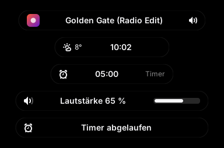 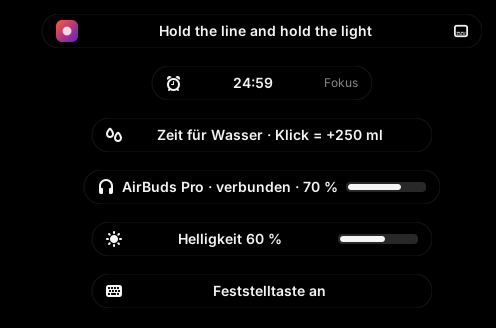

Eingeklappt zeigt sie immer das Wichtigste (Priorität von oben nach unten):

| Zustand          | Inhalt                                                        |
|------------------|---------------------------------------------------------------|
| Live-Aktivität   | **Lautstärke** & **Helligkeit** (ersetzt Cinnamons OSD), **Feststelltaste**, **Tastatur-Sprache**, **Ladegerät eingesteckt**, **WLAN weg / wieder da**, **Kopfhörer verbunden (mit Akku)**, Datei abgelegt, Regen in etwa 1 Std., Aufgabe fällig, Wasser-Erinnerung, Timer/Pomodoro |
| Timer            | Countdown live in der Pille (Timer, Fokus oder Pause)          |
| Lyrics           | Die Zeile, die gerade gesungen wird (optional)                 |
| Musik            | Cover + Titel (Spotify, Firefox/YouTube, VLC, Rhythmbox, … über MPRIS) |
| Minimal-Notch    | Nur ein dünner Strich (Alerts, Lyrics und Hover gehen trotzdem) |
| Maskottchen      | Bist du weg, ruht die Uhr und zwei Augen kommen raus. Sie dösen nach 5 min ein und winken, wenn du zurückkommst. |
| Leerlauf         | Uhrzeit, Temperatur, Akku                                      |


Manche Hinweise sind klickbar: Ein Klick auf die Wasser-Erinnerung trägt eine Portion ein, „Pause vorbei“ startet die nächste Fokus-Runde, und eine fällige Aufgabe öffnet die Aufgabenliste.

### Aufgeklappt: acht Tabs

| Tab | Inhalt |
|---|---|
| 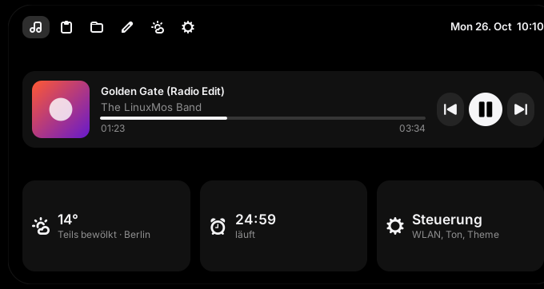 | **Jetzt** – Cover, Titel, ⏮ ⏯ ⏭, **auf den Fortschrittsbalken klicken zum Spulen**; darunter Wetter, Timer, Akku |
| 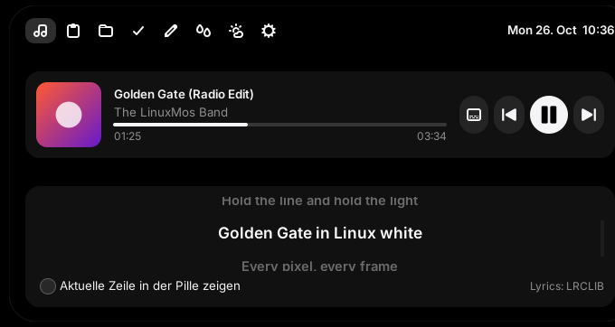 | **Synced Lyrics** – Lyrics-Knopf im Player: Jede Zeile leuchtet auf, während sie gesungen wird. **Klick auf eine Zeile springt dorthin.** Optional zeigt die eingeklappte Pille die aktuelle Zeile. Quelle: [LRCLIB](https://lrclib.net) (kostenlos, ohne Konto). |
| 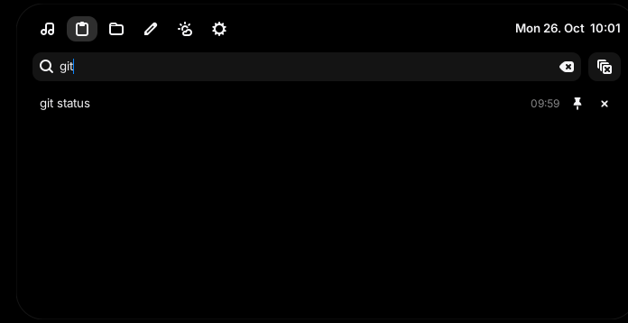 | **Zwischenablage** – Verlauf (Text + Bilder) mit Suche und Pins. **Ein Klick fügt den Eintrag direkt ins Fenster ein, in dem du gerade tippst.** Terminals bekommen automatisch `Ctrl+Shift+V`. Passwörter aus KeePassXC & Co. werden nie gespeichert. |
| 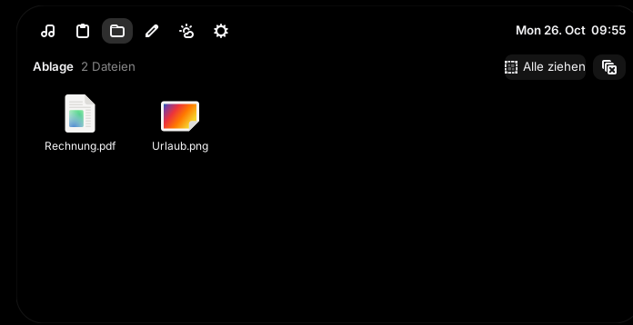 | **Ablage** – Dateien auf die Insel ziehen, sie warten dort, bis du sie in ein anderes Fenster ziehst (einzeln oder „Alle ziehen“). Doppelklick öffnet. Die Dateien bleiben, wo sie sind, gespeichert wird nur der Pfad. |
| 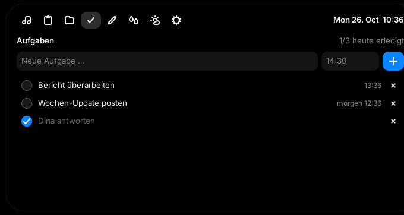 | **Aufgaben** – To-do-Liste mit Erinnerung: Aufgabe eintippen, Zeit dazu (`14:30`, `9`, `in 20 min`, `in 2 h`), und die Insel tippt dir zur Zeit auf die Schulter. Erledigtes von gestern räumt sich selbst auf. |
| 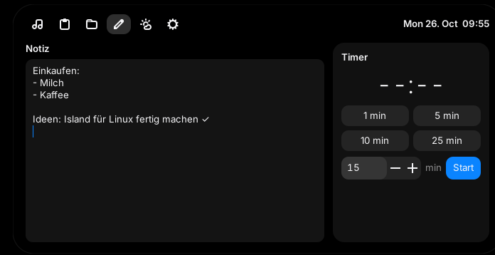 | **Notiz & Fokus** – Notiz, die sich selbst speichert. **Pomodoro**: 25 min Fokus, dann startet die Pause automatisch (jede 4. ist 15 min lang), dazu ein leiser Gong. Dazu normale Timer. |
| 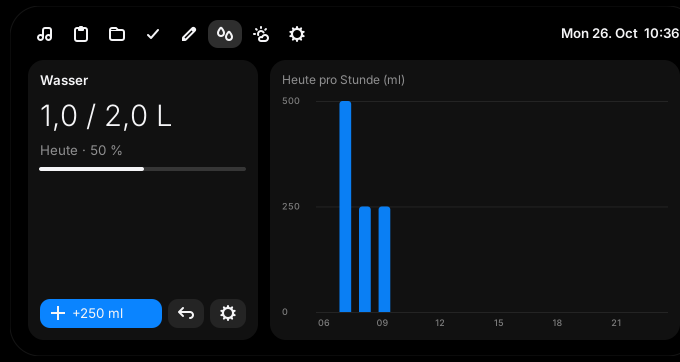 | **Wasser** – Portion (Flasche/Glas) und Tagesziel einstellen, mit einem Klick trinken, Diagramm pro Stunde. Erinnert nur in deinen aktiven Stunden und nur, solange das Ziel nicht erreicht ist. |
| 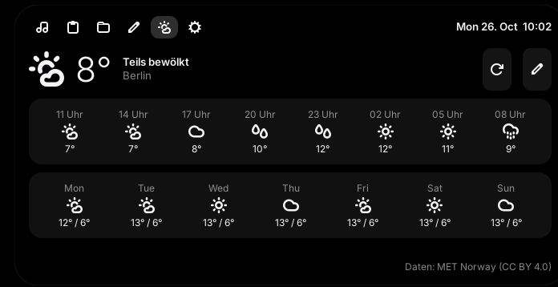 | **Wetter** – jetzt, die nächsten 24 Stunden und 7 Tage. Daten von [MET Norway](https://www.met.no/en), ohne API-Key und ohne Konto; Warnung kurz bevor es zu regnen beginnt. |
| 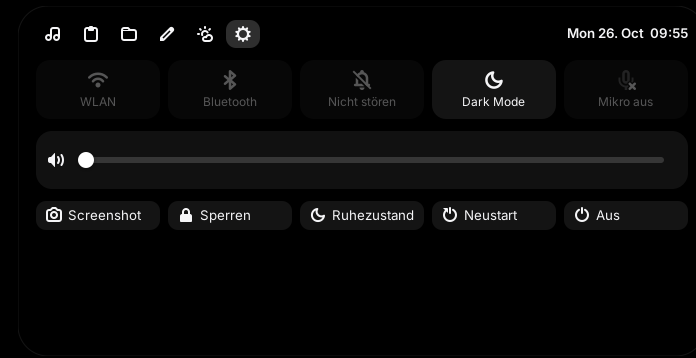 | **Steuerung** – WLAN, Bluetooth, Nicht stören, Dark Mode (schaltet das ganze WhiteSur-Theme um), Mikro aus, Lautstärke, Helligkeit (Laptop), Screenshot, Sperren. Ruhezustand/Neustart/Aus wollen zweimal geklickt werden. |

### Tray-Menü

Das Island-Icon liegt in der Top Bar neben der Uhr (Rechtsklick):

| Schalter                          | Wirkung                                                         |
|-----------------------------------|-----------------------------------------------------------------|
| Mit Cinnamon starten              | Autostart an/aus                                                |
| Maskottchen                       | Augen im Leerlauf an/aus                                        |
| Minimal-Notch                     | Eingeklappt nur ein dünner Strich, z. B. für Laptops mit dickem Rand oben oder damit Browser-Tabs frei bleiben |
| Lautstärke & Helligkeit anzeigen  | Island-Overlays statt Cinnamons eigenem OSD (aus = Cinnamon-OSD zurück) |
| Über Island · Beenden             |                                                                 |

Ein Linksklick aufs Icon klappt die Insel auf.

### Bedienung

| Aktion                        | Wie                                                     |
|-------------------------------|---------------------------------------------------------|
| Aufklappen                    | Maus auf die Pille (oder klicken)                       |
| Zuklappen                     | Maus weg, `Esc`                                         |
| Island öffnen/schließen       | `Ctrl+Alt+I`                                            |
| Zwischenablage                | `Ctrl+Alt+V` → tippen zum Suchen → `Enter` fügt ein     |
| Lautstärke                    | Mausrad auf der eingeklappten Pille                     |
| Dateien ablegen               | Datei aus Nemo/Desktop auf die Pille ziehen             |
| Spulen                        | Klick auf den Fortschrittsbalken oder eine Lyrics-Zeile |

Die Insel **stiehlt nie den Fokus**: Beim Hovern bleibt dein Fenster aktiv. Den Fokus nimmt sie sich nur, wenn du in ein Textfeld klickst oder sie per Tastenkürzel öffnest. Danach gibt sie ihn zurück. Vor Vollbild-Apps (Videos, Spiele) tritt sie automatisch zurück.

Per Terminal steuern:

```bash
linuxmos-island --toggle
linuxmos-island --tab todo          # home|clipboard|shelf|todo|note|water|weather|controls
linuxmos-island --set-city "München"
linuxmos-island --quit
```

### Einstellungen

Die meisten Schalter liegen im Tray-Menü bzw. im Wasser-Tab (⚙). Alles steht außerdem in `~/.config/linuxmos/island/config.json` (nach dem Ändern: `linuxmos-island --quit && linuxmos-island &`):

| Key                  | Default   | Bedeutung                                                    |
|----------------------|-----------|--------------------------------------------------------------|
| `city`               | `""`      | Wetter-Ort (wird einmalig über OpenStreetMap gesucht)         |
| `offset_y`           | `6`       | Abstand zur Top Bar in px                                    |
| `compact_when_idle`  | `false`   | Minimal-Notch                                                |
| `mascot`             | `true`    | Maskottchen                                                  |
| `osd`                | `true`    | Lautstärke-/Helligkeits-Overlays                             |
| `lyrics_in_pill`     | `false`   | Aktuelle Lyrics-Zeile in der eingeklappten Pille             |
| `clipboard_limit`    | `50`      | Einträge im Verlauf (angepinnte zählen nicht)                 |
| `water_portion_ml` / `water_goal_ml` | `250` / `2000` | Portion und Tagesziel                     |
| `water_start` / `water_end` | `09:00` / `21:00` | Aktive Stunden für Erinnerungen                     |
| `water_interval_min` | `60`      | Erinnerung frühestens so lange nach dem letzten Schluck       |
| `water_reminders`    | `true`    | Wasser-Erinnerungen an/aus                                   |

Alle Daten (Notiz, Aufgaben, Wasser-Log, Verlauf, Ablage) liegen nur lokal in `~/.local/share/linuxmos/island/`. Es gibt kein Konto und kein Tracking. Ins Netz gehen nur der Wetter-Abruf (MET Norway, nur die Koordinaten) und die Lyrics-Suche (LRCLIB: Titel, Künstler, Länge), und die nur, wenn du die Lyrics nutzt.

### Performance

| Zustand                                   | CPU (gemessen unter Cinnamon 6, 20 s) |
|-------------------------------------------|---------------------------------------|
| Eingeklappt, Musik läuft, alle Dienste an | 0,1–0,15 %                            |
| Lyrics-Zeile läuft in der Pille mit       | 0,15 %                                |
| Leerlauf (Uhr)                            | 0,0–0,1 %                             |

Möglich wird das, weil es keinen Polling-Loop gibt. Jede Quelle meldet sich von selbst:

| Was                    | Woher                                                         |
|------------------------|---------------------------------------------------------------|
| Musik                  | MPRIS-Signale (D-Bus); die Position rechnet eine lokale Uhr hoch, statt jede Sekunde nachzufragen |
| Lyrics                 | Ein Timer schläft genau bis zum Beginn der nächsten Zeile      |
| Lautstärke             | `pactl subscribe` (blockiert, bis sich etwas ändert)           |
| Helligkeit             | Signal des Cinnamon-Settings-Daemons                          |
| Feststelltaste/Sprache | XKB-Events bzw. gsettings                                      |
| Akku, WLAN, Kopfhörer  | UPower, NetworkManager, BlueZ (D-Bus-Signale)                  |
| Maskottchen            | Muffins IdleMonitor (D-Bus)                                    |
| Aufgaben, Wasser       | Ein einziger Timer bis zur nächsten fälligen Erinnerung        |
| Uhr                    | Einmal pro Minute                                              |

Gezeichnet wird nur, während sich etwas bewegt: beim Auf- und Zuklappen (~240 ms) oder beim Blinzeln des Maskottchens (~180 ms alle paar Sekunden).

**RAM: ~115 MB.** Ehrlich gesagt ist das der größte Posten. Er kommt fast komplett von Python + GTK3 selbst: Ein leeres GTK-Fenster in Python braucht schon ~93 MB. Nusa schafft ~30 MB, weil es in Rust geschrieben ist. Dafür braucht LinuxMos Island keinen Compiler und lässt sich direkt anpassen.

### Was nicht dabei ist

KI-Chat, Texterkennung (OCR), Bildschirmaufnahme, die „Ferrofluid“-Animation und 25 Charaktere (bewusst weggelassen, weil sie dauerhaft CPU kosten), Spiegeln fremder Benachrichtigungen. Die Command Bar übernimmt in LinuxMos die [Spotlight-Suche](#9-spotlight--raycast). Läuft nur unter X11, dem Standard bei Linux Mint Cinnamon.

---

## Aktualisieren

```bash
cd LinuxMos
./update.sh --check       # gibt es etwas Neues?
./update.sh               # aktualisieren
```

`update.sh` macht Folgendes:

1. Es holt die neue LinuxMos-Version (`git pull`) und startet sich danach mit der neuen Fassung selbst neu.
2. Es installiert nur neue Abhängigkeiten nach (kein apt-Lauf, wenn nichts fehlt).
3. Es lädt die WhiteSur-Themes neu (`--no-themes` überspringt das).
4. Es aktualisiert Island, Tools und Skripte und startet die Island neu.

**Deine Einstellungen bleiben**: Panel, Dock, Widget-Positionen, Island-Daten, Wetter-Ort und Tray-Schalter fasst es nicht an. Die Optionen von damals (`--light`, `--island`, …) merkt sich `install.sh` in `~/.local/share/linuxmos/install.conf`.

| Option          | Wirkung                                                          |
|-----------------|------------------------------------------------------------------|
| `--check`       | Nur anzeigen, ob es Updates gibt (mit Änderungsliste)              |
| `--no-themes`   | Themes nicht neu laden (schneller)                                |
| `--full`        | Zusätzlich das Design neu anwenden, wie bei der Installation (setzt Panel/Dock/Effekte zurück auf LinuxMos-Standard) |

Hast du im Repo selbst Dateien geändert, überspringt `update.sh` den `git pull` und sagt dir das. Wurde LinuxMos als ZIP heruntergeladen statt per `git clone`, lädst du die neue Version manuell herunter und startest danach `./update.sh`.

---

## Performance – warum das hier nicht 80 % CPU frisst

### Typische CPU-Fresser bei macOS-Setups unter Linux

| Ursache                                          | Was LinuxMos stattdessen macht                         |
|--------------------------------------------------|--------------------------------------------------------|
| Compositor mit Blur (picom `dual_kawase`, KWin-Blur) | Kein Blur. Transparenz kommt nur aus dem Theme (statisch) |
| Conky mit Lua/Cairo und `update_interval 0.5`    | `conky-std` ohne Lua, Update alle 3–5 s                |
| Cinnamon-Desklets (laufen im Cinnamon-Prozess)   | Conky als eigener, winziger Prozess                    |
| Dock-Animationen in Endlosschleife               | Plank animiert nur beim Hovern oder Starten            |
| Launcher-Daemons (Ulauncher, Albert)             | rofi startet erst auf Tastendruck                      |
| Wetter-Widget, das jede Sekunde pollt            | `curl` alle 30 Minuten                                 |

### Gemessene Werte (Leerlauf)

| Komponente              | CPU      | RAM      |
|-------------------------|----------|----------|
| Conky Uhr (`clock.conf`)  | ~0,00 %  | ~15 MB   |
| Conky System (`stats.conf`) | ~0,03 % | ~15 MB   |
| Plank (ohne Hover)      | ~0 %     | ~30 MB   |
| rofi                    | 0 % (nicht aktiv) | 0 MB |
| Island (optional)       | ~0,1 %   | ~115 MB  |

Die Conky-Werte wurden 30 s lang unter Xorg gemessen, die Island-Werte 20 s lang unter Cinnamon 6. Für Plank und rofi sind es typische Erfahrungswerte.

### Selbst messen

```bash
linuxmos-perf        # misst 5 s lang cinnamon, Xorg, plank, conky, ...
linuxmos-perf 15     # 15 s
```

Wenn die Summe im Leerlauf über ~10 % liegt, stimmt etwas nicht. Dann in dieser Reihenfolge prüfen:

1. **GPU-Treiber**: **Driver Manager** öffnen und den proprietären NVIDIA-Treiber nutzen, falls vorhanden. Ohne richtigen Treiber rendert Cinnamon per CPU (llvmpipe). Prüfen mit:

   ```bash
   glxinfo -B | grep "OpenGL renderer"
   ```

2. **Noch schlanker**: `./install.sh --minimal` schaltet alle Animationen ab.
3. **Widgets aus**: `linuxmos-widgets stop`, dann neu messen.

---

## Anpassen

| Was                        | Wie                                                                              |
|----------------------------|----------------------------------------------------------------------------------|
| Widget-Position            | `gap_x` / `gap_y` / `alignment` in `~/.config/linuxmos/conky/*.conf`, danach `linuxmos-widgets restart` |
| Uhr ohne Datum             | Erste `${alignc}`-Zeile in `clock.conf` löschen                                  |
| Dock-Apps                  | Apps per Drag & Drop ins Dock ziehen; zum Entfernen rausziehen                   |
| Dock-Einstellungen         | `Ctrl` + Rechtsklick aufs Dock → **Preferences**                                 |
| Akzentfarbe Spotlight      | `accent:` in `~/.config/linuxmos/rofi/spotlight.rasi`                            |
| Hell/Dunkel wechseln       | `./install.sh --light` bzw. `./install.sh` erneut ausführen                      |
| Login-Screen               | **Login Window** (Admin) → `Appearance` → Hintergrundbild und Theme wählen       |

## Troubleshooting

<details>
<summary><b>Theme wird nur teilweise angewendet</b></summary>

Einmal ab- und wieder anmelden. Flatpak-Apps brauchen zusätzlich:

```bash
cd ~/.cache/linuxmos/WhiteSur-gtk-theme && ./tweaks.sh -F
```

</details>

<details>
<summary><b>Widgets liegen über den Fenstern oder sind unsichtbar</b></summary>

```bash
linuxmos-widgets restart
```

Wenn sie unsichtbar bleiben: In der jeweiligen `.conf` den Wert `own_window_type = 'normal'` auf `'desktop'` ändern.

</details>

<details>
<summary><b>Super+Space macht nichts</b></summary>

**System Settings → Keyboard → Shortcuts → Custom Shortcuts**: Prüfen, ob „Spotlight (LinuxMos)“ existiert. Nach dem Ändern hilft manchmal `Ctrl+Alt+Esc` (Cinnamon neu laden).

</details>

<details>
<summary><b>Das alte Panel unten ist noch da / das Dock fehlt</b></summary>

`Ctrl+Alt+Esc` lädt Cinnamon neu. Das Dock startest du manuell mit `plank &`.

</details>

<details>
<summary><b>Wetter zeigt „nicht verfügbar“</b></summary>

wttr.in ist manchmal überlastet. Das Widget versucht es alle 30 min automatisch erneut.

</details>

<details>
<summary><b>Island startet nicht</b></summary>

Im Terminal starten, um die Fehlermeldung zu sehen:

```bash
linuxmos-island --quit; linuxmos-island
```

Typische Ursache: Python aus pyenv/conda statt System-Python. Die Insel nutzt bewusst `/usr/bin/python3`, weil nur dort PyGObject (`python3-gi`) installiert ist. Fehlen Pakete, hilft:

```bash
sudo apt install python3-gi python3-gi-cairo gir1.2-gtk-3.0 gir1.2-wnck-3.0 xdotool
```

</details>

<details>
<summary><b>Island: Klick auf einen Clipboard-Eintrag fügt nichts ein</b></summary>

Einfügen braucht `xdotool` (installiert `--island` mit). In Fenstern, die als root laufen, blockiert X11 das. Der Eintrag liegt dann trotzdem in der Zwischenablage, also einfach `Ctrl+V` drücken.

</details>

## Rückgängig machen

```bash
./uninstall.sh           # Einstellungen, Panel, Shortcuts wiederherstellen; Dock und Widgets entfernen
./uninstall.sh --purge   # zusätzlich Themes, Icons, Cursor, Wallpaper und Island-Daten löschen (inkl. Aufgaben, Wasser-Log)
```

Ohne `--purge` bleiben deine Island-Daten (Notiz, Clipboard-Verlauf, Ablage) erhalten.

Pakete entfernst du bei Bedarf manuell:

```bash
sudo apt remove plank conky-std rofi fonts-inter
```

Wenn alles schiefgeht: **Timeshift → Restore** auf den Snapshot „Before LinuxMos“.

## Projektstruktur

```text
install.sh                 Installation (Themes, Panel, Dock, Effekte, Widgets, Spotlight, Island)
update.sh                  Update (git pull, Abhängigkeiten, Themes, Island) ohne Einstellungen zu ändern
uninstall.sh               Wiederherstellung aus dem Backup
lib/cinnamon_tweaks.py     Helfer für Panel, Applets, Shortcuts, Templates
config/conky/              Uhr- und System-Widget
config/rofi/               Spotlight-Theme (Template)
bin/linuxmos-widgets       Widgets starten/stoppen
bin/linuxmos-spotlight     Spotlight öffnen/schließen
bin/linuxmos-perf          CPU-Last messen
bin/linuxmos-island        Island starten/steuern (Hotkeys gehen per D-Bus direkt an die laufende Insel)
island/                    Island (Python + GTK3)
  app.py                   Fenster, Zustände, Hover/Fokus/Einfügen, Drag & Drop, Lyrics-Takt, Pomodoro
  pages.py                 Die acht Tabs
  tray.py                  Tray-Icon mit den Schaltern
  widgets.py               Pillen-Form, Animation, Helfer
  style.css                Look (unabhängig vom GTK-Theme)
  services/                MPRIS, Lyrics, UPower, Overlays (Ton, Helligkeit, Tastatur, Netz, Bluetooth),
                           Leerlauf, Clipboard, Ablage, Aufgaben, Wasser, Wetter, Timer, System-Controls
```

Gesichert wird nach `~/.local/share/linuxmos/backup/`, der Download-Cache liegt in `~/.cache/linuxmos/`.

## Credits & Lizenzen

- [WhiteSur GTK Theme, Icons, Cursors, Wallpapers](https://github.com/vinceliuice) von vinceliuice (GPL-3.0). Die Themes werden beim Installieren direkt vom Original-Repo geladen und sind nicht in diesem Repo enthalten.
- [Plank](https://launchpad.net/plank), [Conky](https://github.com/brndnmtthws/conky), [rofi](https://github.com/davatorium/rofi), [Inter](https://rsms.me/inter/)
- LinuxMos Island ist inspiriert von [Island](https://github.com/exuupery/island) von exuupery und [Nusa](https://rama2555.github.io/nusa/) von Rama (beide Windows, Closed Source). Code und Grafiken sind eigenständig, es besteht keine Verbindung zu den Originalen.
- Lyrics: [LRCLIB](https://lrclib.net)
- Wetterdaten: [MET Norway](https://www.met.no/en) (CC BY 4.0), Ortssuche: [OpenStreetMap](https://www.openstreetmap.org/copyright)-Mitwirkende (ODbL)

Dieses Projekt steht in keiner Verbindung zu Apple Inc. „macOS“ ist eine Marke von Apple Inc.
